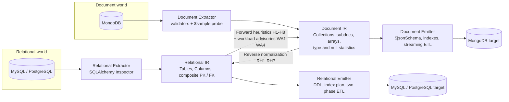
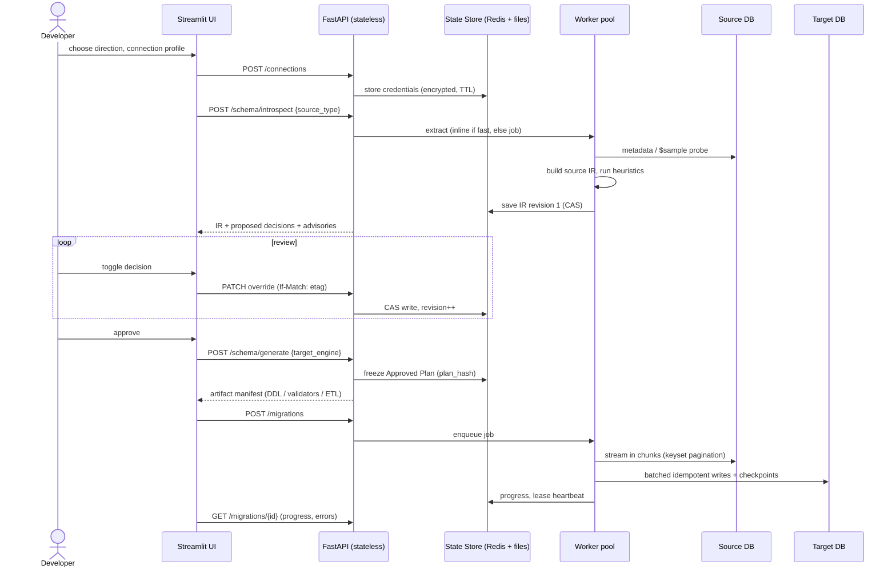
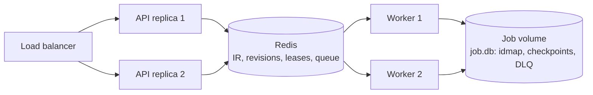
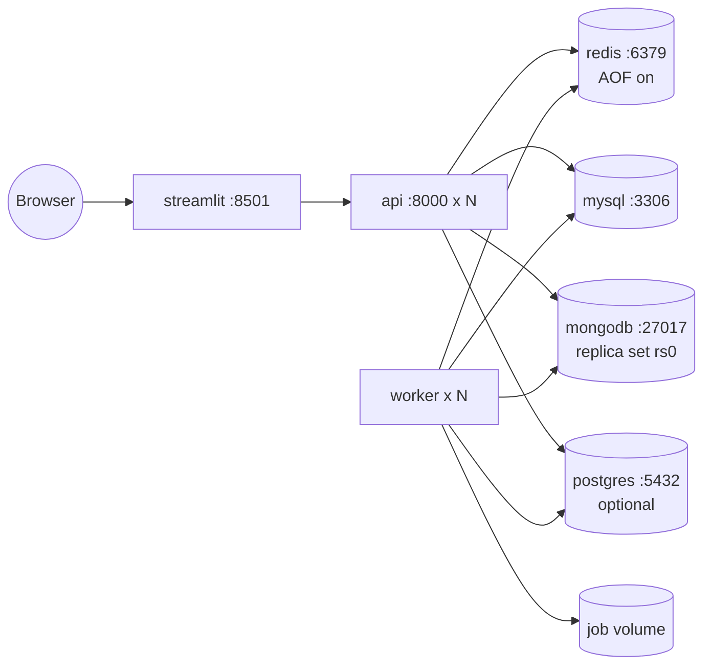

# SynapseMigrate: Architecture

**Bi-directional schema synthesizer and migration engine**
Relational (MySQL / PostgreSQL) ⇄ Document (MongoDB)

| | |
|---|---|
| **Version** | 2.0 (supersedes the one-way "Relational-to-NoSQL Schema Migration Tool", Reviews 1–2) |
| **Team** | Aaryav Rastogi (23BCE0083), Shivam Chandra (23BCE0081), Anushka Arora (23BCE0197) |
| **Guide** | Dr. Lydia Jane G. |
| **Companion docs** | `DESIGN.md` (IR, heuristics, translation, ETL), `API.md` (REST contract) |

---

## 1. System Purpose

SynapseMigrate compiles the *shape* of one database into the idiomatic shape of another, lets a human review and override every structural decision, and then emits executable artifacts (DDL or `$jsonSchema` validators, index plans, ETL programs) plus a fault-tolerant engine that runs the data migration.

| Direction | Source → Target | Core problem solved |
|-----------|-----------------|---------------------|
| **Forward** | MySQL / PostgreSQL → MongoDB | Decide what to **embed** and what to **reference** so the result is access-optimized, not a literal port of relational anti-patterns |
| **Reverse** | MongoDB → MySQL / PostgreSQL | **Normalize** schemaless documents (unnest arrays, flatten subdocuments, extract junctions, tame polymorphism) into a coherent 3NF schema with enforced constraints |

Both directions share one pipeline, one IR family, one override workflow, one ETL runtime and one API.

### 1.1 Goals

1. Correct, explainable structural decisions (every decision carries a rule id, evidence, and alternatives).
2. No silent data-integrity loss: every constraint is translated, or explicitly listed as **not translated**.
3. Human-in-the-loop control over every decision before any artifact is generated.
4. Production-scale ETL: millions of rows, flat memory, resumable, idempotent, observable.
5. Multi-worker safety: no process-local state that matters.

### 1.2 Non-Goals (v2.0)

- Continuous replication / CDC. A snapshot-plus-change-stream mode is on the roadmap; v2.0 documents the consistency limits of snapshot migration (§9).
- Stored procedures, triggers, views and application-code rewriting.
- Automatic query translation between SQL and MQL.

---

## 2. Architectural Style

An **IR-driven compiler pipeline**, structured like a compiler front-end, middle-end and back-end:

| Compiler stage | SynapseMigrate stage | Notes |
|----------------|----------------------|-------|
| Front-end (lexing/parsing) | **Extractors** | Engine-specific. Produce a Relational IR or Document IR |
| Middle-end (optimization passes) | **Heuristics engines** (forward H-rules, reverse RH-rules, workload advisories) | Engine-neutral. Transform one IR kind into the other and annotate decisions |
| Human review | **Override layer** | Decisions are data (`proposed` vs `user_override`), never code paths |
| Back-end (code generation) | **Emitters / Generators** | Engine-specific, Jinja2-template driven |
| Runtime | **ETL engine** | Executes an *immutable, approved plan* |

Supporting principles:

- **Two IR kinds, one envelope.** A *Relational IR* (tables, columns, composite keys) and a *Document IR* (collections, field trees, type/null statistics) share a common `Project` envelope, revisioning, and decision model.
- **Decisions are data.** A heuristic emits `proposed_*`; a human sets `user_override`; the *effective* value is `override ?? proposed`. At approval, effective values are frozen into an immutable **Approved Plan** that ETL executes. Nothing the ETL does depends on mutable IR state.
- **Dependencies point inward.** Domain logic (IR, heuristics, type mapping) knows nothing about SQLAlchemy, PyMongo, HTTP or Redis.
- **Stateless API tier, stateful stores.** All state lives in the State Store (Redis plus durable file snapshots) or in per-job working directories.

---

## 3. Bi-directional Pipeline



The diagram shows the *logical* data flow. Each run is one-directional: forward = `Relational IR → Document IR → Document Emitter`; reverse = `Document IR → Relational IR → Relational Emitter`. The source IR is retained next to the derived IR so decisions stay traceable to the source evidence.

### 3.1 End-to-End Workflow (both directions)



---

## 4. Component Responsibilities

### 4.1 Extractors

| Extractor | Tech | Responsibilities | Output |
|-----------|------|------------------|--------|
| **Relational Extractor** | SQLAlchemy Inspector (`mysql`, `postgresql` dialects) | Tables, columns (type, length, precision, nullability, defaults, enums, auto-increment), **composite** PKs, UNIQUE, CHECK, FKs (**composite**), indexes; row and fan-out statistics (`information_schema` / `pg_stat`, optional exact probes); optional workload profile (`performance_schema`, `pg_stat_user_tables`) | Relational IR |
| **Document Extractor** | PyMongo | Collection list and counts; native `$jsonSchema` validators (`listCollections`); index definitions; **probabilistic `$sample` probe** (default 1,000–5,000 docs, configurable) producing field presence, `null_frequency`, type profile (polymorphism), array length distribution, string length stats, reference-candidate detection; optional full chunked scan for exact stats | Document IR |

Both extractors implement `Extractor.extract(conn, options) -> IR`. Adding a dialect means adding an extractor and a type map. No other layer changes.

### 4.2 IR Store (State Store)

| Concern | Design |
|---------|--------|
| What is stored | Versioned IR documents (Pydantic v2 JSON), keyed by `project_id`; decision overrides; advisories; approved plans; artifact manifests |
| Backends | `RedisStateStore` (primary; AOF `everysec`) and `FileStateStore` (atomic write-then-rename; used for durable snapshots and single-node mode). Both implement `StateStore` |
| Concurrency | **Optimistic concurrency**: every IR has a monotonically increasing `revision` and an `etag`. Writes are compare-and-set (Redis Lua script). A stale writer receives `412 Precondition Failed` |
| History | Last *N* revisions retained (default 50) for undo and audit |
| Locking | `lock:project:{id}` (short TTL) around generate/approve; `lease:job:{id}` with fencing tokens for ETL jobs |
| Credentials | Never stored in the IR, plans, logs or job DB. Stored only as AES-GCM / Fernet envelopes in Redis with TTL (§8.3) |

### 4.3 Heuristics Engines

| Engine | Input → Output | Rule set |
|--------|----------------|----------|
| **Forward (H-rules)** | Relational IR → Document IR decisions | H1–H8, using composite-key-aware cardinality and **tail** fan-out (p95/p99), not averages |
| **Workload Advisor** | Relational IR + workload profile → advisories | WA1–WA4 (write contention, write amplification, growth, skew) |
| **Reverse (RH-rules)** | Document IR → Relational IR decisions | RH1–RH6 mandated, RH7 (reference field → FK column) added to close a gap |

Engines are pure functions over the IR and a `Thresholds` object. They are deterministic, which makes them property-testable and lets the UI re-run them when thresholds change (`POST /schema/ir/{id}/reanalyze`).

### 4.4 Generators / Emitters

| Emitter | Produces |
|---------|----------|
| **Document Emitter** | `$jsonSchema` validators (nested), `createCollection` scripts, index plan, Python/Node.js ETL, report |
| **Relational Emitter** | ANSI/MySQL (and PostgreSQL) `CREATE TABLE` DDL split into `pre-load` and `post-load` scripts, FK constraints (`ON DELETE CASCADE` where the source nesting implies ownership), indexes, **two-phase ETL** program, verification SQL, report |

All emitters are Jinja2-template driven. The report always contains a **"Not translated / lossy"** section.

### 4.5 ETL Engine

A single runtime that executes an Approved Plan in either direction:

- chunked, **keyset** (cursor-based) pagination, never `OFFSET`
- bounded reader → writer queue (back-pressure)
- on-disk **ID map** (SQLite default; LMDB/RocksDB optional) so memory stays flat
- per-unit **checkpoints**, dead-letter log, retry with backoff, batch bisection for poison rows
- idempotent writes (upsert by deterministic key) and `--drop-first`
- verification pass (counts, sampled content hashes, referential integrity)

Details: `DESIGN.md` §8–§10.

### 4.6 API Service (FastAPI)

Stateless. Handles auth, validation, IR CRUD with ETags, override patching, generation, job control, DLQ browsing, and the verified CRUD facade. Long operations return `202` with a job resource. See `API.md`.

### 4.7 Interactive UI (Streamlit)

- **Direction toggle** (Relational → Document / Document → Relational).
- **Forward view:** table/FK graph coloured by EMBED / REFERENCE, document preview, advisory badges.
- **Reverse view:** **document unnesting graph** (collection → subdocs → arrays → resulting tables/junctions), sparsity heat colouring, polymorphism badges, DDL preview.
- Override controls call the PATCH endpoints and refresh the preview.
- Job console: progress, throughput, checkpoint position, DLQ viewer with replay.

### 4.8 Worker Pool

Celery workers (Redis broker) run extraction jobs and ETL jobs. Each ETL job holds an exclusive lease (§7.2). Workers are horizontally scalable and disposable.

---

## 5. Layered View

```
+--------------------------------------------------------------------------+
| Presentation   Streamlit: direction toggle, IR graph, unnesting preview, |
|                override controls, job console, DLQ viewer                |
+--------------------------------------------------------------------------+
| Service        FastAPI (stateless): auth, /schema/*, /migrations/*,      |
|                /connections, /crud/*, /healthz, /metrics                 |
+--------------------------------------------------------------------------+
| Orchestration  Celery workers: extraction jobs, ETL jobs, verification   |
|                Job leases, checkpoints, retry policy                     |
+--------------------------------------------------------------------------+
| Domain         IR models (Relational IR, Document IR, Decisions,         |
| (pure Python)  Approved Plan) | Forward H-rules | Reverse RH-rules |     |
|                Workload advisor | SQL<->BSON type maps | naming rules    |
+--------------------------------------------------------------------------+
| Adapters       Extractors (SQLAlchemy, PyMongo) | Emitters (Jinja2)      |
|                StateStore (Redis, files) | IdMapStore (SQLite/LMDB/      |
|                RocksDB) | SecretVault | Repositories (CRUD)              |
+--------------------------------------------------------------------------+
| Infrastructure MySQL | PostgreSQL | MongoDB | Redis | shared job volume    |
+--------------------------------------------------------------------------+
```

Dependency rule: each layer depends only on layers below it. The Domain layer imports no driver, framework, or I/O library.

---

## 6. Directory Structure

```
synapsemigrate/
├── pyproject.toml
├── docker-compose.yml
├── docs/                                  # ARCHITECTURE.md, DESIGN.md, API.md
├── synapse/
│   ├── api/
│   │   ├── main.py                        # FastAPI app factory
│   │   ├── deps.py                        # auth, state store, vault injection
│   │   ├── errors.py                      # RFC 9457 problem+json handlers
│   │   └── routes/
│   │       ├── connections.py
│   │       ├── schema.py                  # introspect, ir, overrides, reanalyze, generate
│   │       ├── migrations.py              # jobs, checkpoints, errors, verify
│   │       ├── crud_mongo.py              # verified CRUD (MongoDB)
│   │       ├── crud_sql.py                # verified CRUD (MySQL/PostgreSQL)
│   │       └── ops.py                     # healthz, readyz, metrics
│   ├── domain/
│   │   ├── ir/
│   │   │   ├── common.py                  # Project, Decision, Advisory, enums
│   │   │   ├── relational.py              # Table, Column, PrimaryKey, ForeignKey, Relationship
│   │   │   ├── document.py                # Collection, FieldNode, ArrayProfile, FieldDecision
│   │   │   └── plan.py                    # ApprovedPlan (frozen)
│   │   ├── heuristics/
│   │   │   ├── forward.py                 # H1-H8
│   │   │   ├── workload.py                # WA1-WA4
│   │   │   ├── reverse.py                 # RH1-RH7
│   │   │   └── thresholds.py
│   │   ├── typemap/
│   │   │   ├── sql_to_bson.py
│   │   │   ├── bson_to_sql.py
│   │   │   └── constraints.py
│   │   └── naming.py                      # flatten prefixes, 64-char limit, collisions, quoting
│   ├── adapters/
│   │   ├── extractors/
│   │   │   ├── base.py
│   │   │   ├── relational.py              # SQLAlchemy
│   │   │   └── document.py                # PyMongo validators + $sample
│   │   ├── emitters/
│   │   │   ├── document_emitter.py
│   │   │   ├── relational_emitter.py
│   │   │   └── templates/                 # *.j2
│   │   ├── state/
│   │   │   ├── base.py                    # StateStore interface
│   │   │   ├── redis_store.py             # CAS via Lua
│   │   │   └── file_store.py
│   │   ├── idmap/
│   │   │   ├── base.py                    # IdMapStore interface
│   │   │   ├── sqlite_store.py            # default
│   │   │   ├── lmdb_store.py
│   │   │   └── rocksdb_store.py
│   │   ├── vault.py                       # encrypted, TTL'd credentials
│   │   └── repositories/                  # CRUD repositories
│   ├── etl/
│   │   ├── runtime.py                     # reader/writer pipeline, back-pressure
│   │   ├── forward.py                     # SQL -> Mongo executor
│   │   ├── reverse.py                     # Mongo -> SQL two-phase executor
│   │   ├── checkpoint.py
│   │   ├── dlq.py                         # migration_errors.log writer/reader
│   │   ├── retry.py
│   │   ├── verify.py
│   │   └── keys.py                        # composite key encoding, tuple comparison SQL
│   ├── workers/
│   │   └── tasks.py                       # Celery tasks, lease/heartbeat
│   └── cli.py                             # `synapse migrate|resume|replay-errors|verify`
├── ui/
│   └── streamlit_app.py
├── sample/
│   ├── mysql/                             # schema.sql, seed.sql (incl. composite-key tables)
│   └── mongodb/                           # seed.js (nested, polymorphic, sparse docs)
└── tests/
    ├── unit/  integration/  property/  perf/
```

---

## 7. Runtime Model

### 7.1 Stateless API, Durable State



Any API replica can serve any request because the IR, overrides and job metadata are in the State Store. Any worker can pick up any queued job.

### 7.2 Job Leasing and Fencing (multi-worker safety)

1. A worker acquires `lease:job:{id}` (`SET NX PX ttl`) and receives a monotonically increasing **fencing token**.
2. It heartbeats every `ttl/3`. If the heartbeat fails, the worker stops writing immediately.
3. Every checkpoint write carries the fencing token. A checkpoint write with a stale token is rejected, so a zombie worker cannot overwrite a newer worker's progress.
4. If a lease expires, another worker resumes from the last checkpoint. Because target writes are idempotent (upsert), a short overlap cannot corrupt data.

### 7.3 Job Working Directory

Each job owns `/var/lib/synapse/jobs/{job_id}/`:

| File | Purpose |
|------|---------|
| `plan.json` | Frozen Approved Plan (with `plan_hash`) |
| `job.db` | SQLite (WAL): `idmap`, `checkpoint`, `dlq_index` |
| `migration_errors.log` | JSON Lines dead-letter log |
| `report.json` | Final counts, verification results |

For resume on a **different node**, this directory must be on a shared (RWX) volume or object-store-synced. Otherwise the job resumes only on the same node. Deployment profiles in §8.1 state which applies.

---

## 8. Deployment Model

### 8.1 Profiles

| Profile | Components | Use |
|---------|------------|-----|
| **Dev / Demo** | 1 API, 1 worker, Streamlit, Redis (or `FileStateStore`), MySQL, MongoDB, local volume | Course demo, `docker compose up` |
| **Team** | 2+ API, 2+ workers, Redis with AOF, shared volume (NFS/EFS), managed MySQL/Mongo | Shared migration service |
| **Enterprise** | As Team plus OIDC SSO, KMS-backed vault, Prometheus/Grafana, secrets via Vault/KMS, network policies | Regulated environments |

### 8.2 Docker Compose (Dev / Team)



MongoDB runs as a single-node **replica set** in all profiles so multi-document transactions and change streams are available.

### 8.3 Secret Handling (reconciling "credentials never persisted" with resumable jobs)

| Requirement | Mechanism |
|-------------|-----------|
| Credentials never in logs, IR, plans, job DB, DLQ | Structured-log redaction filter; Pydantic `SecretStr` end-to-end; DSNs masked |
| Resumable jobs need credentials after a crash | **Credential escrow**: `POST /connections` encrypts the secret (AES-256-GCM with a KMS/env master key) and stores it in Redis with a TTL (default 8 h). Jobs reference `connection_id`, never the secret |
| TTL expired | Job pauses with `status=waiting_for_credentials`; the user re-supplies a connection and resumes |
| Least privilege | Source user is read-only. Target user needs DDL/DML on the target schema only |

---

## 9. Consistency Model and Known Limits

| Topic | v2.0 behaviour |
|-------|----------------|
| Source consistency | **Default:** each batch reads at `READ COMMITTED` (MySQL/PostgreSQL) or `majority` read concern (MongoDB). Rows modified mid-run may be seen in different states per table. **Option `consistent_snapshot`:** a single `REPEATABLE READ` / `START TRANSACTION WITH CONSISTENT SNAPSHOT` session (relational) or `readConcern: snapshot` with a bounded run time (MongoDB). Trade-off: long transactions bloat undo logs and snapshots have a time limit |
| Cross-collection atomicity | Not provided. Idempotent upserts give eventual convergence; verification reports residual differences |
| Live writes during migration | Out of scope for v2.0 (needs CDC). Recommended approach: quiesce writes, or run the migration against a replica or snapshot |
| Sample-based stats (reverse) | `$sample` gives estimates with confidence intervals. DDL is sized with a safety factor, and ETL detects drift (§DESIGN 9.4) instead of truncating silently |

---

## 10. Non-Functional Requirements

| ID | Requirement | Target | How it is met |
|----|-------------|--------|---------------|
| NFR-1 | Introspection latency, relational | 50+ tables in **< 5 s** | Bulk Inspector calls per table; no per-row queries; fan-out from catalog statistics by default; exact probes opt-in and bounded |
| NFR-2 | Introspection latency, document | Default 2,000-doc probe per collection in **< 10 s** per collection on a 10M-doc collection | `$sample` with `allowDiskUse=false`; probes run in parallel per collection; probes capped by `maxTimeMS` |
| NFR-3 | ETL memory | **O(batch)**, not O(rows). 100M-row migration within a configured `memory_budget_mb` (default 512 MB) | Keyset pagination, bounded queue, on-disk ID map with small LRU cache, adaptive batch size (§DESIGN 8.6) |
| NFR-4 | ETL throughput | ≥ 10k docs/s (forward) and ≥ 8k rows/s (reverse) per worker on commodity hardware, linear scale with units | Batched unordered `bulk_write` / multi-row `INSERT`; parallel units; indexes and FKs deferred in reverse |
| NFR-5 | Resumability | Resume loses at most one batch of work | Checkpoint after each committed batch; idempotent writes |
| NFR-6 | Delivery semantics | **At-least-once delivery, exactly-once effect** | Deterministic keys + upsert; reverse direction commits checkpoint in the same transaction as data |
| NFR-7 | Multi-worker safety | No lost updates to IR; no double-running jobs | CAS revisions; job leases with fencing tokens |
| NFR-8 | Availability of state | No loss of IR on restart | Redis AOF + file snapshots; `StateStore` interface |
| NFR-9 | Security | No credential persistence outside encrypted, TTL'd escrow; RBAC | §8.3, `API.md` §1.2 |
| NFR-10 | Extensibility | Add a SQL dialect or NoSQL engine by adding an extractor, emitter and type map | IR is engine-neutral; engines are plug-ins registered in a registry |
| NFR-11 | Observability | Per-job progress, throughput, error rate, checkpoint lag | Prometheus metrics, structured JSON logs with `job_id`, `request_id` |
| NFR-12 | Data integrity | No silent truncation or coercion | Strict SQL mode, validators, DLQ, "Not translated" report, post-load verification |
| NFR-13 | Determinism | Same input and thresholds give the same plan | Pure heuristics; stable tie-breaking (lexicographic) |

---

## 11. Architecture Decision Records

### ADR-1: IR as the only contract between source and target
- **Status:** Accepted (carried over from v1).
- **Decision:** Extractors and emitters communicate only through IR models.
- **Consequences:** + New engines are isolated. + Overrides are engine-agnostic. − Two IR kinds must be kept in sync with the shared envelope.

### ADR-2: Two IR kinds (Relational IR, Document IR) instead of one universal graph
- **Context:** A single "universal" schema graph hid the key difference. Documents have *nesting and statistical uncertainty*; tables have *declared constraints and composite keys*.
- **Decision:** Keep a Relational IR (exact, declared) and a Document IR (observed, probabilistic), with heuristics as the typed bridge between them.
- **Consequences:** + Each IR models its engine honestly (e.g. `presence_rate`, `null_rate`, type profile). − Two sets of models, but no leaky union types.

### ADR-3: Composite keys everywhere (`list[str]`)
- **Context:** Scalar `primary_key: str` / `foreign_key: str` silently broke junction tables, line-item tables, and any legacy schema with natural keys.
- **Decision:** All key fields are ordered `list[str]`. FKs also record `referenced_columns`. Key values are encoded as **canonical tuples** in the ID map and in checkpoints. Keyset pagination uses tuple comparison.
- **Consequences:** + Correct for real schemas. − Slightly more complex SQL generation (row-value comparisons), isolated in `etl/keys.py`.

### ADR-4: On-disk ID map (SQLite default; LMDB/RocksDB pluggable)
- **Context:** `dict[legacy_id → ObjectId]` grows linearly with row count and fails at tens of millions of rows.
- **Decision:** Persist the mapping in an embedded KV store behind `IdMapStore`, fronted by a bounded LRU cache. `get_or_allocate` makes the mapping **order-independent**, so referencing documents can be written before their parents and FK cycles need no ordering.
- **Why SQLite default:** zero extra dependency, WAL durability, transactions, adequate (hundreds of thousands of ops/s batched). LMDB offers faster reads; RocksDB suits > 1B keys.
- **Consequences:** + Flat memory, resumable. − Local disk required per job (≈ 80 bytes/key). The ID map must travel with the job on resume.

### ADR-5: Persistent, CAS-versioned State Store (Redis + file snapshots)
- **Context:** Process-memory IR is lost on restart and diverges across workers.
- **Decision:** `StateStore` interface with Redis primary (AOF) and file-backed JSON fallback. Optimistic concurrency via `revision`/`etag`.
- **Alternatives rejected:** sticky sessions (fragile), a relational metadata DB (heavier than needed for versioned JSON blobs).
- **Consequences:** + Multi-replica API and multi-worker safe. − Redis becomes a required component in Team/Enterprise profiles.

### ADR-6: Immutable Approved Plan
- **Decision:** `generate` freezes effective decisions, thresholds and naming into `plan.json` with a `plan_hash`. ETL executes only a plan. Resume verifies the hash.
- **Consequences:** + Reproducible, auditable, safe against concurrent IR edits. − Changing a decision after approval needs a new plan (and usually a fresh run).

### ADR-7: Idempotent writes + checkpoints rather than distributed transactions
- **Decision:** Forward: unordered `bulk_write` of upserts keyed by `_id` from the ID map; checkpoint after the batch commit. Reverse: `INSERT … ON DUPLICATE KEY UPDATE` on `legacy_mongo_id` / `(parent_id, position)`; checkpoint row updated **in the same SQL transaction** as the batch.
- **Consequences:** + Exactly-once effect without 2PC. − Requires deterministic keys (guaranteed by ID map and unique constraints). Cross-collection atomicity is not offered (§9).

### ADR-8: Dead-letter queue with batch bisection
- **Decision:** A bad row must never abort a multi-hour run. Failed items go to `migration_errors.log` (JSON Lines) with enough context to replay. For SQL batch failures, **bisect** the batch to isolate the poison rows.
- **Consequences:** + Progress is resilient. − An error budget (`max_error_rate`) is needed to stop runs that are systematically wrong.

### ADR-9: Probabilistic schema inference with explicit confidence
- **Decision:** `$sample` stats carry sample size and Wilson confidence intervals. Rules use conservative bounds (e.g. type widening when a rare type may exist). Optional exact full scan. Validators, when present, are merged with samples, and drift is flagged.
- **Consequences:** + Honest uncertainty. − Slightly wider columns than the minimum.

### ADR-10: Workload advisories instead of auto-decisions
- **Decision:** Workload signals (write contention, amplification, growth, skew) produce **advisories** with severity and a recommended alternative. They do not silently override decisions. HIGH severity requires explicit acknowledgement at generate time.
- **Consequences:** + Human stays in control; + explainable. − Needs a workload profile to be fully effective. Without one, only static proxies run, flagged `WORKLOAD_UNKNOWN`.

### ADR-11: Reverse default PK = surrogate `BIGINT AUTO_INCREMENT` + `legacy_mongo_id` unique (RH6)
- **Decision:** Smaller, clustered-index-friendly PKs and FKs. `legacy_mongo_id` (`VARCHAR(24)` ASCII) is kept for idempotency and traceability. `_id` as the PK is an override.
- **Consequences:** + Compact FKs, fast joins. − An extra unique index.

### ADR-12: Defer FKs and secondary indexes until after load (reverse)
- **Decision:** DDL is split into `pre-load` (tables, PKs, unique keys needed for idempotency) and `post-load` (FKs, secondary indexes). Bulk loading is faster and ordering constraints vanish. Post-load FK creation doubles as a referential-integrity check.
- **Consequences:** + Throughput. − Orphans surface at the end; policy `on_orphan` (`DLQ | NULL | STUB`) is decided in advance.

### ADR-13: Credential escrow with TTL
- See §8.3. Chosen over "memory only" because resumable ETL must survive process death, and over plaintext persistence for obvious reasons.

---

## 12. Risk Register

| Risk | Impact | Mitigation |
|------|--------|-----------|
| Over-embedding leads to documents near the 16 MiB BSON limit | ETL failures, unreadable docs | H5/H6 use p99 fan-out and size estimates; WA3 growth projection; `BSON_TOO_LARGE` goes to the DLQ with a "switch to REFERENCE" hint |
| Write contention on hot embedded parents | Latency, write conflicts | WA1/WA2/WA4 advisories; recommend REFERENCE or bucket pattern |
| Under-sampled Mongo collection misses rare types or long strings | Load-time failures | Wilson bounds, widening rules, drift handling `widen | dlq`, optional full scan |
| Polymorphic fields with many shapes | Unusable relational schema | RH4 demotes to `JSON` / `VARCHAR`; report lists affected paths |
| Orphan references in source (Mongo has no FKs) | FK creation fails | Detect via reference match-rate; `on_orphan` policy; DLQ with the referencing document id |
| Crash mid-batch | Partial writes | Idempotent upserts; checkpoint ordering (data first, checkpoint after) |
| Zombie worker after lease loss | Double writes, stale checkpoints | Fencing tokens; idempotent writes |
| Credential TTL expiry mid-run | Job stalls | `waiting_for_credentials` state; resume with a new `connection_id` |
| Identifier collisions or reserved words after flattening | DDL errors | `naming.py`: dedupe, 64-char truncation with hash suffix, quoting |
| Source changes during migration | Inconsistent copy | §9 options; verification report; CDC on roadmap |

---

## 13. Roadmap (post-2.0)

1. CDC mode: MySQL binlog / PostgreSQL logical decoding / MongoDB change streams (snapshot + live tail).
2. Workload-from-code analysis (ORM and Mongoose model extraction).
3. Graph-assisted hypergraph affinity scoring for forward heuristics.
4. Additional targets (Cassandra wide-column, DynamoDB single-table design).
5. Schema evolution: re-run on changed sources and emit incremental DDL / validator diffs.
