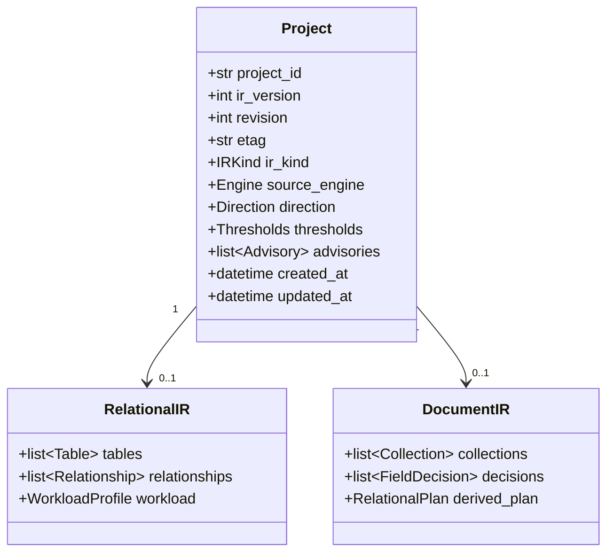
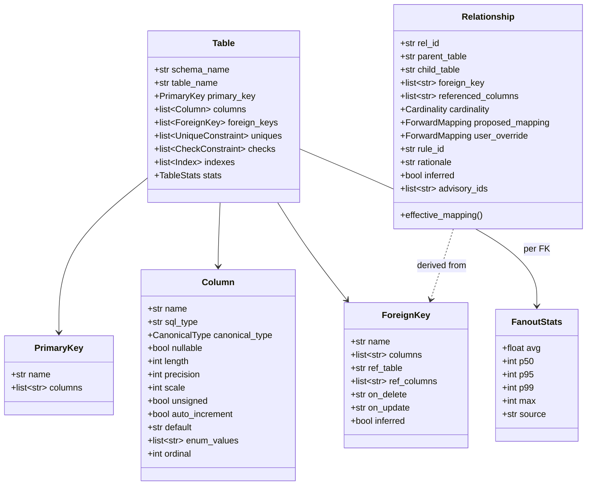
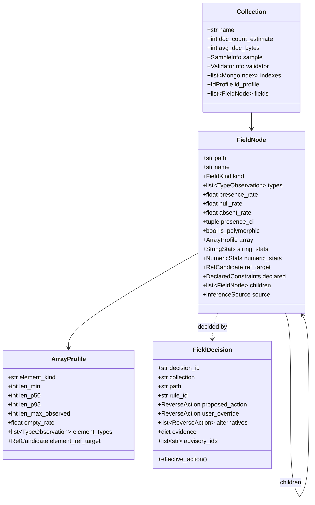
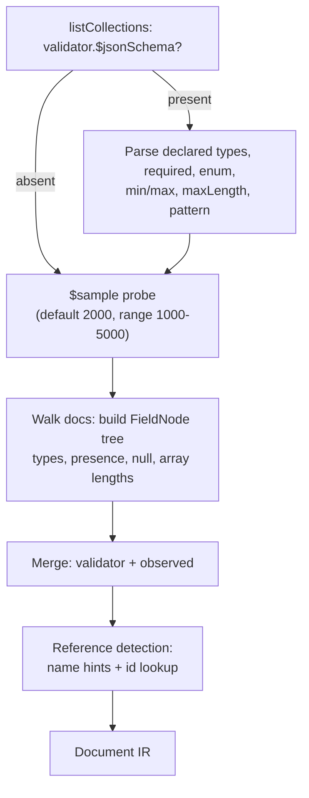
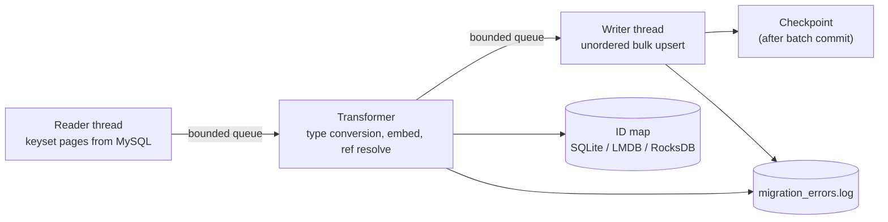
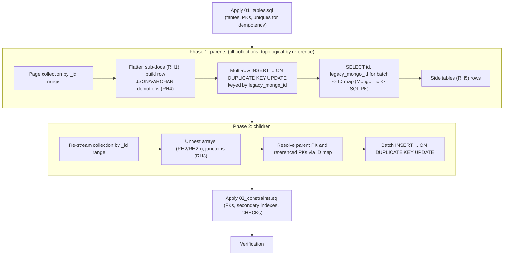

# SynapseMigrate: Detailed Design

Companion to `ARCHITECTURE.md` and `API.md`. Covers the IR, forward and reverse heuristics, workload advisories, bi-directional type/constraint translation, target data models, and the ETL runtime.

**Contents**
1. IR design (class model, Pydantic models, JSON schema)
2. Forward heuristics H1–H8
3. Workload advisories WA1–WA4
4. Document extractor and statistics
5. Reverse heuristics RH1–RH7
6. Type and constraint translation (SQL ⇄ BSON)
7. Target data model examples (both directions)
8. Forward ETL (SQL → MongoDB)
9. Reverse ETL (MongoDB → SQL, two-phase)
10. Shared ETL mechanics: ID map, checkpoints, DLQ, idempotency, verification
11. UI design
12. Error handling matrix
13. Testing strategy

---

## 1. IR Design

### 1.1 Envelope

Both IR kinds live inside a `Project`:



- `direction ∈ {RELATIONAL_TO_DOCUMENT, DOCUMENT_TO_RELATIONAL}`.
- `revision` increments on every accepted write; `etag = sha256(canonical_json)[:16]`.
- `ir_version` is the schema version of the IR itself, used for on-load migrations of stored projects.

### 1.2 Relational IR (composite-key aware)



### 1.3 Pydantic v2 models (relational side)

```python
from __future__ import annotations
from enum import StrEnum
from typing import Annotated, Literal
from pydantic import BaseModel, ConfigDict, Field, model_validator

KeyCols = Annotated[list[str], Field(min_length=1)]          # composite-capable

class CanonicalType(StrEnum):
    INT = "int"; LONG = "long"; DECIMAL = "decimal"; DOUBLE = "double"
    STRING = "string"; TEXT = "text"; BOOL = "bool"
    DATE = "date"; DATETIME = "datetime"; TIME = "time"
    BINARY = "binary"; UUID = "uuid"; JSON = "json"; ENUM = "enum"; UNKNOWN = "unknown"

class Cardinality(StrEnum):
    ONE_TO_ONE = "1:1"; ONE_TO_MANY = "1:N"; MANY_TO_MANY = "M:N"

class ForwardMapping(StrEnum):
    EMBED = "EMBED"                  # 1:1 child merged as sub-document
    EMBED_ARRAY = "EMBED_ARRAY"      # 1:N child stored as array of sub-documents
    REFERENCE = "REFERENCE"          # child remains its own collection, holds parent ref
    REFERENCE_ARRAY = "REFERENCE_ARRAY"  # M:N as array of references

class Strict(BaseModel):
    model_config = ConfigDict(extra="forbid", frozen=False, str_strip_whitespace=True)

class Column(Strict):
    name: str
    sql_type: str                               # raw, e.g. "VARCHAR(255)"
    canonical_type: CanonicalType
    nullable: bool
    length: int | None = None
    precision: int | None = None
    scale: int | None = None
    unsigned: bool = False
    auto_increment: bool = False
    default: str | None = None
    enum_values: list[str] | None = None
    generated: bool = False
    ordinal: int

class PrimaryKey(Strict):
    name: str | None = None
    columns: KeyCols                            # was: primary_key: str

class ForeignKey(Strict):
    name: str | None = None
    columns: KeyCols                            # was: foreign_key: str
    ref_table: str
    ref_columns: KeyCols                        # may reference a UNIQUE key, not only the PK
    on_delete: Literal["CASCADE","SET NULL","RESTRICT","NO ACTION","SET DEFAULT"] = "NO ACTION"
    on_update: Literal["CASCADE","SET NULL","RESTRICT","NO ACTION","SET DEFAULT"] = "NO ACTION"
    inferred: bool = False                      # True when derived from naming convention (H7)

    @model_validator(mode="after")
    def _arity(self):
        if len(self.columns) != len(self.ref_columns):
            raise ValueError("FK column count must equal referenced column count")
        return self

class FanoutStats(Strict):
    avg: float; p50: int; p95: int; p99: int; max: int
    source: Literal["exact", "estimated"]       # exact = probe query; estimated = catalog stats

class TableStats(Strict):
    row_estimate: int = 0
    avg_row_bytes: int = 0
    fanout_by_fk: dict[str, FanoutStats] = {}   # key = FK name
    growth_rows_per_day: float | None = None

class Table(Strict):
    schema_name: str | None = None
    table_name: str
    primary_key: PrimaryKey | None              # None => heap table; handled by RH/H fallbacks
    columns: list[Column]
    foreign_keys: list[ForeignKey] = []
    uniques: list["UniqueConstraint"] = []
    checks: list["CheckConstraint"] = []
    indexes: list["Index"] = []
    stats: TableStats = TableStats()

class Relationship(Strict):
    rel_id: str
    parent_table: str
    child_table: str
    foreign_key: KeyCols                        # child-side columns (list)
    referenced_columns: KeyCols                 # parent-side columns (list)
    cardinality: Cardinality
    proposed_mapping: ForwardMapping
    user_override: ForwardMapping | None = None
    rule_id: str                                # "H4", "H5", ...
    rationale: str
    inferred: bool = False
    advisory_ids: list[str] = []

    @property
    def effective_mapping(self) -> ForwardMapping:
        return self.user_override or self.proposed_mapping
```

> **Backward compatibility:** the v1 IR (`"primary_key": "id"`, `"foreign_key": "user_id"`) is migrated on load by wrapping scalars into one-element lists (`ir_version` 1 → 2).

### 1.4 Document IR (observed, probabilistic)



```python
class FieldKind(StrEnum):
    SCALAR = "scalar"; OBJECT = "object"; ARRAY = "array"; MIXED = "mixed"

class InferenceSource(StrEnum):
    VALIDATOR = "validator"; SAMPLE = "sample"; MERGED = "merged"; FULL_SCAN = "full_scan"

class ReverseAction(StrEnum):
    PLAIN_COLUMN       = "PLAIN_COLUMN"        # scalar -> column
    FLATTEN_COLUMNS    = "FLATTEN_COLUMNS"     # RH1: sub-document -> prefixed columns in parent
    UNNEST_TO_TABLE    = "UNNEST_TO_TABLE"     # RH2: array of objects (or scalars) -> child table
    EXTRACT_JUNCTION   = "EXTRACT_JUNCTION"    # RH3: array of ids -> 2-FK associative table
    RETAIN_AS_JSON     = "RETAIN_AS_JSON"      # RH4/override: keep as native JSON column
    DEMOTE_TO_VARCHAR  = "DEMOTE_TO_VARCHAR"   # RH4: polymorphic scalar -> VARCHAR/TEXT
    SIDE_TABLE_OPTIONAL = "SIDE_TABLE_OPTIONAL"  # RH5: sparse sub-document -> optional 1:1 side table
    FK_COLUMN          = "FK_COLUMN"           # RH7: single ObjectId reference -> FK column
    SURROGATE_PK       = "SURROGATE_PK"        # RH6: BIGINT AUTO_INCREMENT + legacy_mongo_id
    NATURAL_PK_ID      = "NATURAL_PK_ID"       # RH6 override: _id VARCHAR(24) is the PK

class TypeObservation(Strict):
    bson_type: str            # "string","int","long","double","decimal","bool","date",
                              # "objectId","object","array","binData","null",...
    count: int
    rate: float               # count / sample_size

class RefCandidate(Strict):
    collection: str
    match_rate: float         # fraction of sampled ids found in `collection`
    method: Literal["name_hint","lookup","validator_hint","user"]

class ArrayProfile(Strict):
    element_kind: FieldKind
    len_min: int; len_p50: int; len_p95: int
    len_max_observed: int
    empty_rate: float
    element_types: list[TypeObservation]
    element_ref_target: RefCandidate | None = None

class DeclaredConstraints(Strict):             # from native $jsonSchema, when present
    required: bool = False
    bson_types: list[str] = []
    max_length: int | None = None
    min_length: int | None = None
    minimum: float | None = None
    maximum: float | None = None
    enum: list[object] | None = None
    pattern: str | None = None

class FieldNode(Strict):
    path: str                         # "address.city", "orders[].sku"
    name: str
    kind: FieldKind
    types: list[TypeObservation]
    sample_size: int
    presence_rate: float              # P(field exists, null or not)
    null_rate: float                  # P(field exists and is null) -- null_frequency
    absent_rate: float                # 1 - presence_rate
    presence_ci: tuple[float, float]  # 95% Wilson interval
    is_polymorphic: bool              # >1 non-null scalar type, or mixed kind
    array: ArrayProfile | None = None
    string_stats: "StringStats | None" = None      # max/p99 length
    numeric_stats: "NumericStats | None" = None    # min/max, int-valued doubles
    ref_target: RefCandidate | None = None
    declared: DeclaredConstraints | None = None
    children: list["FieldNode"] = []
    source: InferenceSource

class FieldDecision(Strict):
    decision_id: str
    collection: str
    path: str
    rule_id: Literal["RH1","RH2","RH3","RH4","RH5","RH6","RH7","DEFAULT"]
    proposed_action: ReverseAction
    user_override: ReverseAction | None = None
    alternatives: list[ReverseAction]             # legal overrides for this node
    evidence: dict[str, object]                   # e.g. {"absent_rate": 0.82, "n": 2000}
    advisory_ids: list[str] = []

    @property
    def effective_action(self) -> ReverseAction:
        return self.user_override or self.proposed_action
```

**Definitions used by the rules** (all computed over `sample_size = n` documents in the collection or in the parent array scope):

| Metric | Definition |
|--------|-----------|
| `presence_rate` | docs where the field exists (value may be `null`) / n |
| `null_rate` (`null_frequency`) | docs where the field exists with value `null` / n |
| `absent_rate` | 1 − `presence_rate` |
| `empty_rate` (a field's "emptiness") | `absent_rate + null_rate`. Used for sparsity (RH5) and NOT NULL decisions |
| `is_polymorphic` | the non-null type set has size > 1 (ignoring the numeric-compatible set `{int, long}`, which is widened to `long`; `{int,long,double}` becomes `double`/`DECIMAL` after checking integer-valued), or the field is object in some docs and scalar/array in others |
| `presence_ci` | Wilson score interval at 95% for `presence_rate`. Rules use the **conservative bound** (§5.2) |

### 1.5 IR JSON examples

**Relational IR with composite keys** (extends the Review 1/2 `users`, `orders`, `order_items`):

```json
{
  "project_id": "prj_01JC7Q6K",
  "ir_version": 2,
  "revision": 3,
  "etag": "a91c0f7be2d4c8aa",
  "ir_kind": "relational",
  "source_engine": "mysql",
  "direction": "RELATIONAL_TO_DOCUMENT",
  "tables": [
    {
      "table_name": "orders",
      "primary_key": {"columns": ["order_id"]},
      "columns": [
        {"name": "order_id", "sql_type": "BIGINT", "canonical_type": "long", "nullable": false, "unsigned": true, "auto_increment": true, "ordinal": 1},
        {"name": "user_id",  "sql_type": "BIGINT", "canonical_type": "long", "nullable": false, "ordinal": 2}
      ],
      "foreign_keys": [
        {"name": "fk_orders_user", "columns": ["user_id"], "ref_table": "users", "ref_columns": ["id"], "on_delete": "RESTRICT"}
      ],
      "stats": {
        "row_estimate": 4800000, "avg_row_bytes": 96,
        "fanout_by_fk": {"fk_orders_user": {"avg": 31.2, "p50": 9, "p95": 120, "p99": 800, "max": 41020, "source": "exact"}}
      }
    },
    {
      "table_name": "order_items",
      "primary_key": {"columns": ["order_id", "line_no"]},
      "columns": [
        {"name": "order_id", "sql_type": "BIGINT", "canonical_type": "long", "nullable": false, "ordinal": 1},
        {"name": "line_no",  "sql_type": "INT",    "canonical_type": "int",  "nullable": false, "ordinal": 2},
        {"name": "sku",      "sql_type": "VARCHAR(32)", "canonical_type": "string", "nullable": false, "length": 32, "ordinal": 3}
      ],
      "foreign_keys": [
        {"name": "fk_items_order", "columns": ["order_id"], "ref_table": "orders", "ref_columns": ["order_id"], "on_delete": "CASCADE"}
      ]
    },
    {
      "table_name": "shipment_lines",
      "primary_key": {"columns": ["order_id", "line_no"]},
      "foreign_keys": [
        {"name": "fk_ship_item", "columns": ["order_id", "line_no"], "ref_table": "order_items", "ref_columns": ["order_id", "line_no"]}
      ]
    }
  ],
  "relationships": [
    {
      "rel_id": "rel_002", "parent_table": "users", "child_table": "orders",
      "foreign_key": ["user_id"], "referenced_columns": ["id"],
      "cardinality": "1:N", "proposed_mapping": "REFERENCE", "user_override": null,
      "rule_id": "H5", "rationale": "p99 fan-out 800 > N_hard (100); unbounded growth",
      "inferred": false, "advisory_ids": ["adv_007"]
    },
    {
      "rel_id": "rel_003", "parent_table": "order_items", "child_table": "shipment_lines",
      "foreign_key": ["order_id", "line_no"], "referenced_columns": ["order_id", "line_no"],
      "cardinality": "1:1", "proposed_mapping": "EMBED", "user_override": null,
      "rule_id": "H1", "rationale": "child PK equals composite FK set => 1:1",
      "inferred": false, "advisory_ids": []
    }
  ],
  "advisories": [
    {"advisory_id": "adv_007", "rule_id": "WA3", "severity": "MEDIUM", "target": "rel_002",
     "message": "Projected max fan-out in 12 months: 61,000", "recommendation": "keep REFERENCE; consider bucket pattern for order history"}
  ]
}
```

**Document IR (excerpt, `customers` collection)**:

```json
{
  "project_id": "prj_01JC9AB2",
  "ir_kind": "document",
  "source_engine": "mongodb",
  "direction": "DOCUMENT_TO_RELATIONAL",
  "collections": [
    {
      "name": "customers",
      "doc_count_estimate": 12400000,
      "avg_doc_bytes": 1120,
      "sample": {"strategy": "$sample", "requested": 2000, "taken": 2000, "full_scan": false},
      "validator": null,
      "id_profile": {"types": [{"bson_type": "objectId", "rate": 1.0}]},
      "fields": [
        {"path": "email", "kind": "scalar", "types": [{"bson_type": "string", "count": 2000, "rate": 1.0}],
         "presence_rate": 1.0, "null_rate": 0.0, "absent_rate": 0.0, "presence_ci": [0.998, 1.0],
         "is_polymorphic": false, "string_stats": {"max_len": 88, "p99_len": 61}, "source": "sample"},
        {"path": "address", "kind": "object", "presence_rate": 0.97, "null_rate": 0.0, "absent_rate": 0.03,
         "is_polymorphic": false, "source": "sample",
         "children": [
           {"path": "address.city", "kind": "scalar", "presence_rate": 0.97, "string_stats": {"max_len": 60, "p99_len": 31}}
         ]},
        {"path": "loyalty", "kind": "object", "presence_rate": 0.18, "null_rate": 0.02, "absent_rate": 0.82,
         "is_polymorphic": false, "source": "sample"},
        {"path": "orders", "kind": "array",
         "array": {"element_kind": "object", "len_min": 0, "len_p50": 3, "len_p95": 14, "len_max_observed": 46, "empty_rate": 0.21,
                   "element_types": [{"bson_type": "object", "count": 6120, "rate": 1.0}]}},
        {"path": "tag_ids", "kind": "array",
         "array": {"element_kind": "scalar", "len_p50": 2, "len_p95": 9, "len_max_observed": 20,
                   "element_types": [{"bson_type": "objectId", "rate": 1.0}],
                   "element_ref_target": {"collection": "tags", "match_rate": 0.998, "method": "lookup"}}},
        {"path": "metadata", "kind": "scalar", "is_polymorphic": true,
         "types": [{"bson_type": "string", "rate": 0.4}, {"bson_type": "int", "rate": 0.35}, {"bson_type": "object", "rate": 0.25}]}
      ]
    }
  ],
  "decisions": [
    {"decision_id": "dec_001", "collection": "customers", "path": "address", "rule_id": "RH1",
     "proposed_action": "FLATTEN_COLUMNS", "alternatives": ["RETAIN_AS_JSON", "SIDE_TABLE_OPTIONAL"],
     "evidence": {"absent_rate": 0.03, "max_depth": 1, "n": 2000}},
    {"decision_id": "dec_002", "collection": "customers", "path": "loyalty", "rule_id": "RH5",
     "proposed_action": "SIDE_TABLE_OPTIONAL", "alternatives": ["FLATTEN_COLUMNS", "RETAIN_AS_JSON"],
     "evidence": {"empty_rate": 0.84, "threshold": 0.70, "n": 2000}},
    {"decision_id": "dec_003", "collection": "customers", "path": "orders", "rule_id": "RH2",
     "proposed_action": "UNNEST_TO_TABLE", "alternatives": ["RETAIN_AS_JSON"], "evidence": {"len_p95": 14}},
    {"decision_id": "dec_004", "collection": "customers", "path": "tag_ids", "rule_id": "RH3",
     "proposed_action": "EXTRACT_JUNCTION", "alternatives": ["UNNEST_TO_TABLE", "RETAIN_AS_JSON"],
     "evidence": {"ref_collection": "tags", "match_rate": 0.998}},
    {"decision_id": "dec_005", "collection": "customers", "path": "metadata", "rule_id": "RH4",
     "proposed_action": "RETAIN_AS_JSON", "alternatives": ["DEMOTE_TO_VARCHAR"],
     "evidence": {"types": {"string": 0.4, "int": 0.35, "object": 0.25}}}
  ]
}
```

### 1.6 Approved Plan (frozen)

At `generate`, effective decisions are compiled into an immutable plan:

```json
{
  "plan_id": "pln_01JCA",
  "plan_hash": "sha256:5c1e…",
  "project_id": "prj_01JC9AB2",
  "ir_revision": 14,
  "direction": "DOCUMENT_TO_RELATIONAL",
  "target_engine": "mysql",
  "thresholds": {"…": "…"},
  "naming": {"customers.address.city": "address_city"},
  "units": [
    {"unit_id": "customers", "phase1": ["customers", "customer_loyalty"], "phase2": ["customer_orders", "customer_tags"]}
  ],
  "etl_options": {"batch_size": 2000, "on_drift": "widen", "on_orphan": "DLQ", "max_error_rate": 0.01}
}
```

ETL reads only the plan; `plan_hash` is verified on resume.

---

## 2. Forward Heuristics (H1–H8): Relational → Document

### 2.1 Inputs and Preprocessing

1. **FK groups.** Each FK is a *group* (`columns` ↔ `ref_columns`). Composite FKs are treated as a unit; a partial match is never a relationship.
2. **Cardinality classification** for FK `F` from child `C` to parent `P`:
   - `C.pk_columns == F.columns` as sets, **or** a UNIQUE constraint on `C` with column set equal to `F.columns` → **1:1**.
   - `C` is a **junction** (see H2) → **M:N** between the two parents.
   - otherwise → **1:N**.
3. **Fan-out statistics** per FK: `avg, p50, p95, p99, max`. Source `exact` (probe: `SELECT COUNT(*) c … GROUP BY fk_cols`, summarised by quantiles) or `estimated` (`row_estimate(C) / row_estimate(P)` with a `×skew_factor`, default 4, when no probe was run). **Rules use p99, not the average**, because a few huge parents determine the 16 MiB risk.
4. **Identity of "referenced by others":** `in_degree(T)` = number of FK groups from other tables (excluding the candidate parent) pointing at `T`.
5. **Graph:** build directed graph `child → parent` over FK groups. Compute strongly connected components (Tarjan) for H8.

### 2.2 Rule Table

Rules are evaluated per relationship **in this priority order**; the first rule that fires decides.

| Rule | Condition | Decision | Rationale | Config |
|------|-----------|----------|-----------|--------|
| **H8** (checked first) | The FK edge lies on a cycle, including **self-reference** (`employees.manager_id → employees.id`) | `REFERENCE` for the chosen back-edge | Embedding on a cycle is infinite or ambiguous | Edge choice: the edge with the highest `p99` fan-out; ties broken lexicographically by `(child_table, fk_name)`. Remaining edges are evaluated by H1–H7 on the now acyclic graph |
| **H7** | No declared FK, but the column set matches `<parent>_id` / `<parent>_<pk_col>` and types agree and (optionally) value-containment probe ≥ 99% | Evaluated with H1–H6 but flagged `inferred=true`, requires confirmation in UI | Legacy schemas without FK constraints | `infer_implicit_fks` (default true) |
| **H2** | `C` has exactly 2 FK groups whose columns together cover the PK, **and** no other non-key columns → pure junction | `REFERENCE_ARRAY` on the side with the smaller expected degree (ties: parent with lower `row_estimate`) | M:N cannot be embedded without duplication | `junction_payload_cols = 0` |
| **H2b** | Junction with payload columns (e.g. `enrollments(student_id, course_id, grade)`) | Treated as an **entity**: child collection with two references | Payload makes it a first-class entity | |
| **H1** | Cardinality 1:1 | `EMBED` (sub-document in parent) unless H3 or H6 applies | Always read together, atomic update | |
| **H3** | `in_degree(C) > 0` from other tables, or `C` has its own children that are `REFERENCE`d | `REFERENCE` | `C` is a shared entity; embedding would duplicate | |
| **H5** | 1:N and `p99_fanout > N_hard` (default 100) **or** `growth_unbounded` (child has an auto-timestamp column and `growth_rows_per_day × horizon_days` exceeds `N_hard`) | `REFERENCE` | Prevents 16 MiB overflow and huge arrays | `N_hard=100`, `horizon_days=365` |
| **H6** | `est_embedded_bytes = p99_fanout × avg_child_bytes > S_max` (default 1 MiB) | `REFERENCE` | Keeps documents small | `S_max=1 MiB` |
| **H4** | 1:N, `p95_fanout ≤ N_soft` (default 20) and `p99_fanout ≤ N_hard`, and not H3/H5/H6 | `EMBED_ARRAY` | Bounded, read with parent | `N_soft=20` |
| **default** | None of the above | `REFERENCE` | Safe fallback; flagged for review | |

> **Why order matters.** H8 and H7 shape the graph first. H2/H2b then removes junctions. H1/H3/H5/H6 are *vetoes* on embedding. H4 is the *positive* rule for embedding. Anything ambiguous falls to `REFERENCE`.

### 2.3 Algorithm

```python
def propose_forward(ir: RelationalIR, th: Thresholds) -> list[Relationship]:
    graph = build_fk_graph(ir, infer=th.infer_implicit_fks)          # H7 adds inferred FKs
    back_edges = choose_cycle_breakers(graph)                        # H8, deterministic
    rels = []
    for fk in graph.edges_sorted():                                  # stable order
        child, parent = fk.child, fk.parent
        card = classify_cardinality(child, fk, graph)                # 1:1 / 1:N / M:N
        fo = child.stats.fanout_by_fk.get(fk.key) or estimate_fanout(child, parent, th)

        if fk in back_edges:                          rule, m = "H8", REFERENCE
        elif is_pure_junction(child):                 rule, m = "H2", REFERENCE_ARRAY
        elif is_payload_junction(child):              rule, m = "H2b", REFERENCE
        elif card is ONE_TO_ONE:
            rule, m = ("H3", REFERENCE) if graph.in_degree(child, exclude=parent) else ("H1", EMBED)
        elif graph.in_degree(child, exclude=parent) > 0:  rule, m = "H3", REFERENCE
        elif fo.p99 > th.n_hard or growth_unbounded(child, th):    rule, m = "H5", REFERENCE
        elif fo.p99 * child.stats.avg_row_bytes > th.s_max:        rule, m = "H6", REFERENCE
        elif fo.p95 <= th.n_soft:                     rule, m = "H4", EMBED_ARRAY
        else:                                         rule, m = "DEFAULT", REFERENCE

        rels.append(Relationship(..., proposed_mapping=m, rule_id=rule,
                                 rationale=explain(rule, fo, th), inferred=fk.inferred))
    return rels
```

**Multi-level embedding.** After all relationships are decided, embedded children are resolved bottom-up (post-order). A table embedded into parent *P* may itself embed its children. If that makes the **root document** exceed `S_max`, the deepest embedded edge with the highest estimated bytes is flipped to `REFERENCE` (rule `H6`, rationale "transitive size"), and the check repeats.

**Several parents.** If a table has FK groups to two parents and both would embed it, H3 does not apply (in-degree excludes the candidate parent), so the engine picks the parent with the **higher read affinity**: lower `p99_fanout`, tie-break by lexicographic parent name. The other edge becomes `REFERENCE`.

### 2.4 Worked Example (sample schema)

| Relationship | Cardinality | Stats | Rule | Result |
|--------------|-------------|-------|------|--------|
| users → user_addresses | 1:N | p95=3, p99=4 | H4 | `EMBED_ARRAY` |
| users → orders | 1:N | p99=800, growth | H5 | `REFERENCE` |
| orders → order_items | 1:N, composite PK `(order_id, line_no)` | p99=40 | H4 | `EMBED_ARRAY` |
| order_items → shipment_lines | 1:1 (composite FK equals composite PK) | n/a | H1 | `EMBED` |
| students ↔ courses via `enrollments(student_id, course_id)` | M:N | pure junction | H2 | `REFERENCE_ARRAY` |
| employees.manager_id → employees.id | self-reference | n/a | H8 | `REFERENCE` |

---

## 3. Workload Advisories (WA1–WA4)

Heuristics H1–H8 look at *structure and size*. They cannot see *how the data is written*. A table with a tiny fan-out can still be a bad embed target if it is written heavily and concurrently. Advisories add that dimension **without** silently changing decisions (ADR-10).

### 3.1 Workload Profile

Sources, in priority order:

| Source | Signals |
|--------|---------|
| User-supplied JSON (`workload.profile`) | Per-table `reads_per_sec`, `inserts_per_sec`, `updates_per_sec`, `deletes_per_sec`, `p95_concurrent_writers_per_parent` |
| MySQL `performance_schema.table_io_waits_summary_by_table`, `sys.schema_table_statistics` | Cumulative `COUNT_INSERT/UPDATE/DELETE/READ`; rates derived by sampling twice `workload_window_s` apart |
| PostgreSQL `pg_stat_user_tables` (`n_tup_ins/upd/del`) | Same |
| Statement digests (`events_statements_summary_by_digest`) | Co-access (tables read together) and write fan-in |
| None | Static proxies only: mutable columns (`status`, `updated_at`, counters) imply update-heavy; append-only logs imply growth. Emit `WORKLOAD_UNKNOWN` (INFO) |

### 3.2 Advisory Rules

Only evaluated for relationships whose **effective** mapping is `EMBED` or `EMBED_ARRAY`.

| Rule | Detects | Formula | Thresholds (defaults) | Severity | Recommendation |
|------|---------|---------|----------------------|----------|----------------|
| **WA1** Write contention | Several writers updating the **same** parent document concurrently. MongoDB serializes writes to one document, so conflicts cause retries, higher latency, and `TransientTransactionError`s inside transactions | By Little's law, expected concurrent writers on the hottest parent `L = λ_hot × W`, where `λ_hot` = child writes/s on one parent (p95 over the window) and `W` = target write latency (default 8 ms) | `L ≥ 0.25` → MEDIUM; `L ≥ 0.5` → HIGH. Also HIGH if `p95_concurrent_writers_per_parent ≥ 3` | MEDIUM / HIGH | Switch to `REFERENCE`; or the *bucket* pattern (documents of N children) |
| **WA2** Write amplification | Small child updates cause a rewrite of a large parent document. Storage cost, cache pressure and journal/checkpoint volume scale with document size | `amp = est_parent_doc_bytes / avg_child_bytes`; `load = child_update_rate × amp` | `amp ≥ 50` and `child_updates/s ≥ 10` → MEDIUM; `amp ≥ 200` and `child_updates/s ≥ 10` → HIGH | MEDIUM / HIGH | `REFERENCE`, or split mutable fields from immutable ones (subset pattern) |
| **WA3** Unbounded growth | Low fan-out now, but append-only child growth will exceed limits | `projected_max = p99_now + growth_rows_per_day_per_parent × horizon_days` | `projected_max > N_hard` → MEDIUM; `projected_bytes > 0.5 × 16 MiB` → HIGH | MEDIUM / HIGH | `REFERENCE`; bucket pattern with TTL / archival |
| **WA4** Skew | Average looks fine, but a few hot parents are huge | `skew = p99 / max(p50, 1)` | `skew ≥ 20` and `p99 > N_soft` → MEDIUM | MEDIUM | `REFERENCE`; or outlier pattern (embed up to *k*, overflow flag + side collection) |

**Pure-read tables** (updates + inserts + deletes ≈ 0) never trigger WA1/WA2.

### 3.3 Advisory Model and Gating

```python
class Advisory(Strict):
    advisory_id: str
    rule_id: Literal["WA1","WA2","WA3","WA4","WORKLOAD_UNKNOWN","BSON_SIZE_RISK"]
    severity: Literal["INFO","MEDIUM","HIGH"]
    target: str                      # rel_id or decision_id
    message: str
    metrics: dict[str, float]        # the numbers behind the verdict
    recommendation: str
    acknowledged_by: str | None = None
    acknowledged_at: datetime | None = None
```

- `POST /schema/generate` fails with `409 advisory_ack_required` while any **HIGH** advisory is un-acknowledged. Acknowledge via `POST /schema/ir/{id}/advisories/{adv_id}/acknowledge` (records user and time) or by overriding the decision.
- Advisories are recomputed on `reanalyze`; acknowledgements persist per `(rule_id, target)` until metrics change by > 25%.

---

## 4. Document Extractor and Statistics

### 4.1 Sources and Precedence



**Merge rules (`source = merged`):**

| Situation | Result |
|-----------|--------|
| Validator declares type *T*; sample observes only *T* | Use *T*; `DeclaredConstraints` attached |
| Validator declares *T*; sample observes additional types (validator `validationLevel: moderate/off`, or `validationAction: warn`) | **Union** of types, `is_polymorphic=true`, advisory `VALIDATOR_DRIFT` (MEDIUM) |
| Validator lists field as `required`; sample shows `absent_rate > 0` | Keep nullable in DDL (observed wins), advisory `VALIDATOR_DRIFT` |
| Validator absent | Observed only (`source = sample`) |
| `additionalProperties: false` declared | Observed set cannot contain undeclared fields; any found is reported as drift |

### 4.2 Sampling

- **Strategy:** `aggregate([{ $sample: { size: n } }], { maxTimeMS, allowDiskUse: false })`. For collections ≤ `n` docs, the full collection is read. `n` is configurable (1,000–5,000; default 2,000). Larger collections or low-variance requirements can use `full_scan=true` (chunked `_id`-range scan, exact statistics, source `full_scan`).
- **Randomness caveat.** `$sample` is uniform only when MongoDB uses its random-cursor path (collection is large relative to `n`); otherwise it falls back to a sort-based path whose cost grows. The extractor records `strategy` and warns when it observes the fallback via `explain`.
- **Complement with tail probes.** To catch recent schema versions, additionally read the newest `m=200` docs by `_id` descending (ObjectIds are time-ordered) and tag them `recency_probe=true`; types seen **only** there are still included (conservative), but flagged `new_in_recent_docs`.
- **Parallelism:** one probe per collection, thread pool `probe_concurrency` (default 4).

### 4.3 Per-field Statistics

| Statistic | How |
|-----------|-----|
| Type profile | Counter per `bson_type` per path. Arrays record element types separately |
| `presence_rate`, `null_rate`, `absent_rate` | Counted per path. For paths inside arrays of objects, the denominator is the number of **array elements** at that scope, not parent docs |
| Confidence interval | Wilson score interval for `presence_rate` |
| Polymorphism | `is_polymorphic` per §1.4; mixed container kinds set `kind = mixed` |
| String lengths | max, p99 (t-digest), used for `VARCHAR(n)` sizing |
| Numeric | min, max, integer-valued flag for doubles, decimal precision/scale from `Decimal128` |
| Arrays | length min/p50/p95/max observed, `empty_rate`, element kind, element types |
| Depth | max nesting depth (guards against runaway recursion; default limit 8, deeper → `RETAIN_AS_JSON`) |
| Reference detection | For ObjectId-typed fields and arrays: (1) name hints (`user_id`, `tagIds`, `ref`), (2) **lookup**: take up to 200 sampled ids, run `find({_id: {$in: ids}})` against each candidate collection, `match_rate = found / sampled`. A match ≥ 0.9 sets `ref_target` (method `lookup`) |

### 4.4 Handling Sampling Uncertainty

- **Sizing:** `VARCHAR(n)` is sized from `max(declared.max_length, p99_len × 1.5, observed_max × 1.25)` rounded up to the bucket set `{32, 64, 128, 255, 512, 1024, 4096, 16383}`; above 16383 → `TEXT`/`MEDIUMTEXT` (row-size aware).
- **NOT NULL:** a column is `NOT NULL` only when `empty_rate = 0` **and** the Wilson lower bound for presence ≥ `0.995`, or the validator declares it required. Otherwise nullable.
- **Drift at load time** (a value outside the inferred type or length) is handled by `on_drift` (§9.5), never truncated silently.

---

## 5. Reverse Heuristics (RH1–RH7): Document → Relational (3NF)

### 5.1 Overview

The goal is a **3NF** schema: scalars become columns of the owning table; repeating groups become child tables (1NF); each non-key attribute depends on the key (2NF); transitive dependencies are not introduced by flattening (3NF), and embedded copies of another entity are detected via reference detection (RH7/RH3) rather than duplicated.

Rules are evaluated per node by a depth-first walk of the `FieldNode` tree, with **priority**:

`RH6 (root identity)` → per field: `type/kind gate (RH4)` → `RH7 / RH3 / RH2 (arrays, references)` → `RH5 (sparsity)` → `RH1 (flatten)` → `PLAIN_COLUMN`.

### 5.2 Rule Table

| Rule | Applies to | Condition (conservative) | Action | Resulting structure |
|------|-----------|--------------------------|--------|---------------------|
| **RH6** Root identifier | Every collection `_id` | `_id` type is `objectId` (default) | `SURROGATE_PK` | Table PK `id BIGINT UNSIGNED AUTO_INCREMENT`; `legacy_mongo_id VARCHAR(24) ASCII NOT NULL UNIQUE` |
| | | User override | `NATURAL_PK_ID` | PK is `_id VARCHAR(24)`; no surrogate |
| | | `_id` is string/int/UUID/`binData`4 | Surrogate PK; `legacy_mongo_id` becomes `legacy_id` with the right type | |
| | | `_id` is a **sub-document** | Surrogate PK; flatten `_id.*` fields into a **composite UNIQUE** key (`legacy_id_<field>`) | |
| **RH4** Polymorphic | Field with `is_polymorphic` or `kind = mixed` | All observed types are scalars of the same family (e.g. `string` + `int` + `double`) | `DEMOTE_TO_VARCHAR` | `VARCHAR(n)`/`TEXT`, values serialized canonically |
| | | Observed set includes `object`/`array` with scalars, or > 2 distinct shapes, or depth > 8 | `RETAIN_AS_JSON` | native `JSON` column (`JSONB` on PostgreSQL) |
| | | Numeric-only (`int, long, double, decimal`) | **Not polymorphic**: widen (see §6.2) | `BIGINT` / `DOUBLE` / `DECIMAL` |
| **RH1** 1:1 sub-document | `kind = object` (non-polymorphic), `absent_rate + null_rate ≤ 0.70`, depth ≤ `max_flatten_depth` (default 3), column count after flatten ≤ `max_flatten_cols` (default 40) | `FLATTEN_COLUMNS` | Columns `<prefix>_<child>` in the parent (e.g. `address.city` → `address_city`). Children nullable unless every ancestor is required and the child is required |
| **RH2** Embedded array of objects | `kind = array`, `element_kind = object`, element type homogeneous (`rate ≥ 0.95` objects) | `UNNEST_TO_TABLE` | Child table `<parent>_<array>` with surrogate PK `id`, FK `<parent>_id` → parent PK (`ON DELETE CASCADE`), `position INT` (preserves order), `UNIQUE(<parent>_id, position)`. Element fields recurse (flatten/nested arrays become grandchildren with FK to the child's `id`) |
| **RH2b** Array of scalars | `kind = array`, scalar elements, not ids | `UNNEST_TO_TABLE` (value table) | `<parent>_<array>(id, <parent>_id, position, value)` |
| **RH3** M:N via array of ids | `kind = array`, elements `objectId`, `element_ref_target.match_rate ≥ 0.9` | `EXTRACT_JUNCTION` | Associative table `<parent>_<target>` with composite PK `(<parent>_id, <target>_id)` and 2 FKs. If duplicates occur in sampled arrays **and** order matters (user flag), add `position` and PK `(parent_id, position)` |
| **RH7** Single reference | scalar `objectId` (or `_id`-typed) field with `ref_target.match_rate ≥ 0.9` | `FK_COLUMN` | Column `<field>` → FK to target's surrogate PK (translated in Phase 2 via ID map); `legacy_*` kept only on the target |
| **RH5** Sparse sub-document | `kind = object` (or array-of-objects element group) with `empty_rate = absent_rate + null_rate > 0.70` (conservative: lower Wilson bound of `empty_rate` > 0.70) | `SIDE_TABLE_OPTIONAL` | Optional 1:1 table `<parent>_<field>` with `<parent>_id` as **PK and FK** (`ON DELETE CASCADE`); a row exists only when the sub-document exists |
| **DEFAULT** | Scalar | One type family | `PLAIN_COLUMN` | Typed column (§6.2) |

### 5.3 Decision Tables

**Container fields (object):**

| `is_polymorphic` | depth ≤ max | `empty_rate` | cols ≤ max | Decision |
|------------------|-------------|--------------|------------|----------|
| true | any | any | any | RH4 `RETAIN_AS_JSON` |
| false | no | any | any | `RETAIN_AS_JSON` (depth guard) |
| false | yes | > 0.70 | any | **RH5** `SIDE_TABLE_OPTIONAL` |
| false | yes | ≤ 0.70 | yes | **RH1** `FLATTEN_COLUMNS` |
| false | yes | ≤ 0.70 | no | `SIDE_TABLE_OPTIONAL` (width guard) |

**Array fields:**

| Element kind | Element condition | Decision |
|--------------|-------------------|----------|
| object | homogeneous | **RH2** `UNNEST_TO_TABLE` |
| object | heterogeneous (< 95% same shape) | RH4 `RETAIN_AS_JSON` |
| `objectId` | `match_rate ≥ 0.9` | **RH3** `EXTRACT_JUNCTION` |
| `objectId` | `match_rate < 0.9` / unknown | RH2b value table (ids as `VARCHAR(24)`), advisory `UNRESOLVED_REFERENCE` |
| scalar (string/number/…) | homogeneous | RH2b value table |
| scalar | mixed types | `RETAIN_AS_JSON` |
| array (nested array) | any | `RETAIN_AS_JSON` unless user overrides to unnest with a `position2` column |
| mixed (object + scalar) | any | `RETAIN_AS_JSON` |

### 5.4 Algorithm

```python
def propose_reverse(ir: DocumentIR, th: Thresholds) -> list[FieldDecision]:
    out: list[FieldDecision] = []
    for coll in ir.collections:
        out.append(decide_root_id(coll, th))                         # RH6
        for node in walk(coll.fields, max_depth=th.max_depth):       # DFS, stable order by path
            out.append(decide_node(node, coll, th))
    return out

def decide_node(n, coll, th):
    if n.is_polymorphic or n.kind is MIXED:
        return rh4(n, th)                                            # DEMOTE_TO_VARCHAR | RETAIN_AS_JSON
    if n.kind is ARRAY:
        a = n.array
        if a.element_kind is OBJECT and homogeneous(a, 0.95):  return RH2(n)
        if is_objectid_array(a):
            return RH3(n) if a.element_ref_target and a.element_ref_target.match_rate >= th.ref_match else RH2b(n)
        if is_scalar_array(a) and not mixed(a):                return RH2b(n)
        return json_fallback(n, "RH4")
    if n.kind is OBJECT:
        if depth(n) > th.max_flatten_depth:                        return json_fallback(n, "RH4")
        if lower_wilson(n.empty_rate, n.sample_size) > th.sparse_object:   # 0.70
            return RH5(n)
        if flat_column_count(n) > th.max_flatten_cols:             return RH5(n, reason="width")
        return RH1(n)
    if is_ref_scalar(n, th):                                       return RH7(n)
    return PlainColumn(n)
```

### 5.5 Naming (`naming.py`)

| Concern | Rule |
|---------|------|
| Flatten prefix | `parent_child`, joining path segments with `_` (`address.geo.lat` → `address_geo_lat`) |
| Child table name | `<parent_table>_<array_field>` (`customers.orders[]` → `customer_orders` after singularize/pluralize option) |
| Case | `snake_case` from camelCase (`firstName` → `first_name`) |
| Reserved words | Backtick (MySQL) or double-quote (PostgreSQL) quoting; or suffix `_` if `quote_reserved=false` |
| Max length | 64 chars (MySQL), 63 (PostgreSQL). Truncate and append `_` + 6-char hash of the full path |
| Collisions | `address_city` vs an existing top-level `address_city` field → suffix `_2` and record in the plan's `naming` map |
| Stability | Mapping `path → identifier` is recorded in the plan. Re-running never renames silently |

### 5.6 Overrides (reverse)

| From | Allowed override targets |
|------|--------------------------|
| `FLATTEN_COLUMNS` | `RETAIN_AS_JSON`, `SIDE_TABLE_OPTIONAL` |
| `UNNEST_TO_TABLE` | `RETAIN_AS_JSON` (keeps the array as a `JSON` column) |
| `EXTRACT_JUNCTION` | `UNNEST_TO_TABLE` (values as `VARCHAR(24)` with no FK), `RETAIN_AS_JSON` |
| `SIDE_TABLE_OPTIONAL` | `FLATTEN_COLUMNS`, `RETAIN_AS_JSON` |
| `DEMOTE_TO_VARCHAR` | `RETAIN_AS_JSON` |
| `RETAIN_AS_JSON` | any structural action valid for the node kind (the UI warns about possible type drift) |
| `SURROGATE_PK` | `NATURAL_PK_ID` |

Illegal overrides (e.g. `EXTRACT_JUNCTION` on an object field) return `422 override_not_allowed`.

---

## 6. Type and Constraint Translation (SQL ⇄ BSON)

### 6.1 Forward: SQL → BSON

| MySQL | PostgreSQL | BSON type | `$jsonSchema` extras | Notes |
|-------|-----------|-----------|----------------------|-------|
| `TINYINT`, `SMALLINT`, `MEDIUMINT`, `INT` | `smallint`, `integer` | `int` | `minimum`/`maximum` for UNSIGNED | |
| `INT UNSIGNED` | n/a | `long` | `minimum: 0` | Exceeds int32 |
| `BIGINT` | `bigint` | `long` | | `BIGINT UNSIGNED` > 2^63 → `decimal` (warning) |
| `DECIMAL(p,s)` / `NUMERIC` | `numeric(p,s)` | `decimal` | | Default; `double` only by option (loses precision) |
| `FLOAT`, `DOUBLE` | `real`, `double precision` | `double` | | |
| `VARCHAR(n)`, `CHAR(n)` | `varchar(n)`, `char(n)` | `string` | `maxLength: n` | |
| `TEXT` family | `text` | `string` | | |
| `ENUM('a','b')` | `enum` type | `string` | `enum: ["a","b"]` | |
| `SET('a','b')` | n/a | `array` of `string` | `items.enum` | |
| `DATE`, `DATETIME`, `TIMESTAMP` | `date`, `timestamp[tz]` | `date` | | Stored UTC; naive `DATETIME` interpreted with `source_tz` option; zero-dates (`0000-00-00`) → `null` + DLQ warning |
| `TIME` | `time` | `string` (ISO `HH:MM:SS`) | `pattern` | No native BSON time |
| `YEAR` | n/a | `int` | | |
| `BOOLEAN` / `TINYINT(1)` | `boolean` | `bool` | | |
| `JSON` | `json`, `jsonb` | `object` or `array` | | |
| `BLOB` family / `BINARY` | `bytea` | `binData` | | |
| `BINARY(16)` (UUID) / `uuid` | `uuid` | `binData` subtype 4 | | |
| `GEOMETRY`, `POINT` | PostGIS | `object` (GeoJSON) | | Only if conversion enabled; else warning |
| Auto-increment PK | `serial` | `_id: ObjectId` + `_legacy` (§8.2) | | Original value preserved |

### 6.2 Reverse: BSON → SQL

| BSON type | MySQL 8 | PostgreSQL | Notes |
|-----------|---------|-----------|-------|
| `string` | `VARCHAR(n)` sized per §4.4; `TEXT`/`MEDIUMTEXT` beyond 16383 | `VARCHAR(n)` / `TEXT` | `utf8mb4` |
| `int` | `INT` | `INTEGER` | |
| `long` | `BIGINT` | `BIGINT` | |
| `int` + `long` | `BIGINT` | `BIGINT` | Widening, not polymorphic |
| `double` | `DOUBLE` | `DOUBLE PRECISION` | |
| `double` observed as integer-valued only | `BIGINT` if `prefer_int=true` (default false) | same | Only with explicit option |
| `decimal` (Decimal128) | `DECIMAL(p,s)` from observed (default `DECIMAL(38,10)`; max 65,30) | `NUMERIC(p,s)` | |
| `int`/`long`/`double`/`decimal` mix | `DECIMAL(38,10)` if any `decimal`; else `DOUBLE` | `NUMERIC` / `DOUBLE PRECISION` | |
| `bool` | `TINYINT(1)` (`BOOLEAN`) | `BOOLEAN` | |
| `date` | `DATETIME(3)` (UTC) | `TIMESTAMPTZ(3)` | **Not** `TIMESTAMP` in MySQL (2038 limit). Millisecond precision preserved |
| `timestamp` (internal) | `BIGINT` | `BIGINT` | Rare; warning |
| `objectId` (as `_id`) | `legacy_mongo_id VARCHAR(24) CHARACTER SET ascii COLLATE ascii_bin` | `CHAR(24)` | RH6 |
| `objectId` (reference) | FK column of the target's PK type (`BIGINT UNSIGNED`) | `BIGINT` | RH7/RH3, translated in Phase 2 |
| `objectId` (unresolved) | `VARCHAR(24)` ASCII | `CHAR(24)` | Advisory |
| `binData` generic | `VARBINARY(n)` / `LONGBLOB` | `BYTEA` | |
| `binData` subtype 4 (UUID) | `BINARY(16)` | `UUID` | |
| `object` / `array` fallback | `JSON` | `JSONB` | RH4 / overrides |
| `regex`, `javascript`, `symbol`, `minKey/maxKey`, `dbPointer` | `TEXT` (serialized) | `TEXT` | Report lists as lossy |
| `null` only | `VARCHAR(1) NULL` | `TEXT NULL` | Warning: no type information |
| `undefined` | treated as `null` | | |

### 6.3 Constraint Translation

| Direction | Source construct | Target construct | Notes |
|-----------|------------------|------------------|-------|
| SQL → Mongo | `NOT NULL` | `required` entry | |
| | nullable | `bsonType: [T, "null"]` or field optional | Configurable |
| | `VARCHAR(n)` | `maxLength` | |
| | `ENUM` | `enum` | |
| | `UNIQUE` (single/composite) | unique index (composite → compound unique) | Validators cannot enforce uniqueness |
| | `FOREIGN KEY` | reference field + index | **Not enforced by MongoDB**; verified during ETL; app-level thereafter |
| | `CHECK (x > 0)` | `minimum`/`maximum`/`exclusiveMinimum` for simple comparisons; `pattern` for simple `REGEXP`; otherwise listed as **not translated** | |
| | `DEFAULT` | applied at ETL time; not persisted by validators | |
| | `AUTO_INCREMENT` | `_legacy.pk` preserved; new docs use `ObjectId` | |
| | composite PK | `_legacy.pk` array plus unique compound index on the embedded field set where applicable | |
| Mongo → SQL | validator `required` / presence 100% and null 0% | `NOT NULL` | Conservative bounds (§4.4) |
| | `maxLength` / observed max | `VARCHAR(n)` | |
| | `enum` | `VARCHAR(n)` + `CHECK (col IN (…))` (MySQL ≥ 8.0.16 enforces CHECK) or native `ENUM` option | |
| | `minimum`/`maximum` | `CHECK (col BETWEEN …)` | |
| | `pattern` | `CHECK (REGEXP_LIKE(col, 'pattern'))` (MySQL); `~` (PostgreSQL). Dialect differences flagged | |
| | unique index (single/compound) | `UNIQUE KEY` | Multikey unique index on an array → `UNIQUE(parent_id, value)` in the child table |
| | non-unique index | `KEY` / `INDEX` (compound preserved) | Index on a flattened path → index on the flattened column |
| | index on an unnested array field | index on the child column | |
| | partial index | `WHERE` clause unsupported in MySQL → **not translated** (PostgreSQL: partial index) | |
| | TTL, text, 2dsphere, hashed, wildcard indexes | **not translated** | Report lists them with alternatives (generated columns, FULLTEXT, spatial) |
| | `_id` uniqueness | `legacy_mongo_id UNIQUE` | |
| | sub-document ownership | FK with `ON DELETE CASCADE` | Child rows die with the parent |
| | reference field | FK (RH7/RH3) | `ON DELETE RESTRICT` for plain references; `CASCADE` for owned data |

---

## 7. Target Data Model Examples

### 7.1 Forward: MySQL → MongoDB (with composite keys)

Source (excerpt): `users`, `user_addresses`, `orders`, `order_items(order_id, line_no)`, `shipment_lines(order_id, line_no)`.

```javascript
db.createCollection("orders", {
  validator: { $jsonSchema: {
    bsonType: "object",
    required: ["user_id", "status", "placed_at", "items"],
    properties: {
      _id: { bsonType: "objectId" },
      user_id: { bsonType: "objectId", description: "ref users" },
      status: { enum: ["PLACED", "PAID", "SHIPPED", "CANCELLED"] },
      total: { bsonType: "decimal" },
      placed_at: { bsonType: "date" },
      items: {
        bsonType: "array",
        items: {
          bsonType: "object",
          required: ["line_no", "sku", "qty", "unit_price"],
          properties: {
            line_no:    { bsonType: "int" },
            sku:        { bsonType: "string", maxLength: 32 },
            qty:        { bsonType: "int", minimum: 1 },
            unit_price: { bsonType: "decimal" },
            shipment:   {                         // EMBED (1:1, composite FK == composite PK)
              bsonType: "object",
              properties: { carrier: { bsonType: "string" }, shipped_at: { bsonType: "date" } }
            }
          }
        }
      },
      _legacy: { bsonType: "object", properties: { table: { bsonType: "string" }, pk: { bsonType: "array" } } }
    }
  }},
  validationLevel: "strict", validationAction: "error"
});
db.orders.createIndex({ user_id: 1, placed_at: -1 });
db.orders.createIndex({ "_legacy.pk": 1 }, { unique: true });   // idempotent upsert / verification
```

Generated document (`order_items` embedded, FK columns dropped, composite key kept as `line_no`):

```json
{
  "_id": {"$oid": "670a1f3c9d2e4b0012ab34cd"},
  "user_id": {"$oid": "66f1e0a47c8d3a0011ff9a01"},
  "status": "SHIPPED",
  "items": [
    {"line_no": 1, "sku": "SKU-1042", "qty": 2, "unit_price": {"$numberDecimal": "499.00"},
     "shipment": {"carrier": "BlueDart", "shipped_at": {"$date": "2026-09-12T08:00:00Z"}}},
    {"line_no": 2, "sku": "SKU-2077", "qty": 1, "unit_price": {"$numberDecimal": "1299.00"}}
  ],
  "total": {"$numberDecimal": "2297.00"},
  "placed_at": {"$date": "2026-09-10T00:00:00Z"},
  "_legacy": {"table": "orders", "pk": [88123]}
}
```

### 7.2 Reverse: MongoDB → MySQL

Source document (`customers`):

```json
{
  "_id": {"$oid": "65f0c0de0000000000000001"},
  "email": "aarya.n@example.com",
  "address": {"city": "Chennai", "line1": "12 MG Road", "pincode": "600001"},
  "loyalty": {"tier": "GOLD", "points": 1840},
  "orders": [
    {"sku": "SKU-1042", "qty": 2, "unit_price": {"$numberDecimal": "499.00"}},
    {"sku": "SKU-2077", "qty": 1, "unit_price": {"$numberDecimal": "1299.00"}}
  ],
  "tag_ids": [{"$oid": "65f0aa000000000000000010"}, {"$oid": "65f0aa000000000000000011"}],
  "metadata": {"source": "mobile", "ab": [1, 2]},
  "created_at": {"$date": "2026-08-01T00:00:00Z"}
}
```

Generated `pre-load` DDL (`01_tables.sql`):

```sql
SET sql_mode = 'STRICT_ALL_TABLES,NO_ZERO_DATE,NO_ZERO_IN_DATE,ERROR_FOR_DIVISION_BY_ZERO';

CREATE TABLE customers (
  id               BIGINT UNSIGNED NOT NULL AUTO_INCREMENT,
  legacy_mongo_id  VARCHAR(24) CHARACTER SET ascii COLLATE ascii_bin NOT NULL,      -- RH6
  email            VARCHAR(128) NOT NULL,
  address_city     VARCHAR(128) NULL,                                               -- RH1
  address_line1    VARCHAR(255) NULL,
  address_pincode  VARCHAR(16)  NULL,
  metadata         JSON NULL,                                                       -- RH4
  created_at       DATETIME(3) NOT NULL,
  PRIMARY KEY (id),
  UNIQUE KEY uq_customers_legacy_mongo_id (legacy_mongo_id),
  UNIQUE KEY uq_customers_email (email)
) ENGINE=InnoDB DEFAULT CHARSET=utf8mb4 COLLATE=utf8mb4_0900_ai_ci;

CREATE TABLE customer_loyalty (                                                     -- RH5 (82% absent)
  customer_id BIGINT UNSIGNED NOT NULL,
  tier        VARCHAR(32) NULL,
  points      INT NULL,
  PRIMARY KEY (customer_id)
) ENGINE=InnoDB;

CREATE TABLE customer_orders (                                                      -- RH2
  id          BIGINT UNSIGNED NOT NULL AUTO_INCREMENT,
  customer_id BIGINT UNSIGNED NOT NULL,
  position    INT NOT NULL,
  sku         VARCHAR(64) NOT NULL,
  qty         INT NOT NULL,
  unit_price  DECIMAL(38,10) NOT NULL,
  PRIMARY KEY (id),
  UNIQUE KEY uq_customer_orders_pos (customer_id, position)
) ENGINE=InnoDB;

CREATE TABLE customer_tags (                                                        -- RH3
  customer_id BIGINT UNSIGNED NOT NULL,
  tag_id      BIGINT UNSIGNED NOT NULL,
  PRIMARY KEY (customer_id, tag_id)
) ENGINE=InnoDB;
```

Generated `post-load` DDL (`02_constraints.sql`, applied after Phase 2):

```sql
ALTER TABLE customer_loyalty
  ADD CONSTRAINT fk_loyalty_customer FOREIGN KEY (customer_id) REFERENCES customers(id) ON DELETE CASCADE;
ALTER TABLE customer_orders
  ADD CONSTRAINT fk_orders_customer  FOREIGN KEY (customer_id) REFERENCES customers(id) ON DELETE CASCADE,
  ADD KEY ix_customer_orders_sku (sku);
ALTER TABLE customer_tags
  ADD CONSTRAINT fk_ctags_customer FOREIGN KEY (customer_id) REFERENCES customers(id) ON DELETE CASCADE,
  ADD CONSTRAINT fk_ctags_tag      FOREIGN KEY (tag_id)      REFERENCES tags(id)      ON DELETE RESTRICT,
  ADD KEY ix_customer_tags_tag (tag_id);
ALTER TABLE customer_orders ADD CONSTRAINT chk_orders_qty CHECK (qty >= 1);
```

---

## 8. Forward ETL: SQL → MongoDB

### 8.1 Execution Model



- **Unit of work** = one root collection (a root table plus all tables embedded into it, transitively). Units run in parallel (`unit_concurrency`, default 2); they need no ordering because references are resolved via `get_or_allocate` (§10.1).
- **Bounded queues** (`max_inflight_batches`, default 2) apply back-pressure so a slow target cannot cause unbounded buffering.

### 8.2 Keyset (cursor-based) Pagination, composite-key aware

Never `OFFSET`; page by primary key tuple:

```sql
-- first page
SELECT … FROM orders ORDER BY order_id LIMIT :batch;

-- next page, single-column key
SELECT … FROM orders WHERE order_id > :last_order_id ORDER BY order_id LIMIT :batch;

-- next page, composite key (a, b): row-value comparison
SELECT … FROM order_items
WHERE (order_id, line_no) > (:last_order_id, :last_line_no)
ORDER BY order_id, line_no
LIMIT :batch;
```

- MySQL and PostgreSQL both support row-value comparison; when the optimizer fails to use the composite index (older versions), `keys.py` emits the expanded form `(a > :a) OR (a = :a AND b > :b)`.
- Tables **without a PK** use a unique non-null index; otherwise the extractor flags the table and ETL falls back to `PARTITION`-style range chunks on a monotonic column, or refuses with `NO_STABLE_KEY` unless the user supplies `key_hint`.
- **Chunk parallelism** (optional): split the key range into N sub-ranges using sampled quantiles; each sub-range has its own checkpoint.

### 8.3 Fetching Children without Memory Blow-up

For parent batch `[k_first … k_last]` (ordered by PK), children are fetched **by range**, not by a giant `IN` list:

```sql
SELECT … FROM order_items
WHERE (order_id) >= :first AND (order_id) <= :last
ORDER BY order_id, line_no;
```

- Works for composite FKs through row-value ranges on the FK's leading columns.
- Children are grouped by FK tuple **within the batch only** (a dict of at most `batch × fan-out` entries).
- **Merge-join mode** (when the child index prefix equals the FK columns): children are consumed from a streaming cursor in lock-step with parents, so only the current parent's children are in memory.
- A **guard**: if a single parent has > `max_children_per_parent` (default 10,000) children, or its estimated BSON size exceeds 12 MiB, the document is **not built**; it goes to the DLQ with `BSON_TOO_LARGE` and hint "switch relationship to REFERENCE".
- For deeper embedding (orders → items → shipment), steps repeat recursively per level.

### 8.4 Transformation

1. Convert types with `typemap/sql_to_bson.py` (`Decimal` → `Decimal128`, naive datetimes → UTC with `source_tz`, `TINYINT(1)` → `bool`, `ENUM` → string, `BLOB` → `Binary`).
2. Build the document: embedded children as arrays or sub-documents; **FK columns of embedded children are dropped**; composite key components that carry meaning (`line_no`) are kept.
3. `_id` ← `idmap.get_or_allocate("orders", (order_id,))`.
4. Reference fields ← `idmap.get_or_allocate("users", (user_id,))` (allocation is lazy; no need for the user document to exist yet).
5. `_legacy = {table, pk: [..]}` (root collections; optional for embedded children via `preserve_child_legacy_ids`).
6. Check BSON size; send to DLQ if too large.

### 8.5 Writing: Batches, Retries, Idempotency

```python
ops = [ReplaceOne({"_id": doc["_id"]}, doc, upsert=True) for doc in batch]
res = coll.bulk_write(ops, ordered=False, bypass_document_validation=False)
```

- **Idempotent:** `_id` comes from the persistent ID map, so a replayed batch overwrites the same documents.
- **Unordered** so one bad document does not stop the batch; `BulkWriteError.details.writeErrors` yields per-document failures (validator code **121**, duplicate key **11000**, document too large **10334/17419**) → DLQ.
- **Transient errors** (`NotWritablePrimary`, network timeouts, `91`, `189`, `11602`): retry the whole batch with exponential backoff + jitter (1 s → 30 s, max 6 attempts). Because writes are idempotent, retry is safe.
- **Batch transactions (optional, `use_transactions=true`, requires a replica set):** one multi-document transaction per batch for cross-collection consistency when a unit writes to several collections. Batch size is then limited (≤ 1,000 docs / 16 MB oplog entry) and `TransientTransactionError` is retried with the same semantics. Default is **off**: per-document atomicity is enough because each embedded aggregate is a single document.
- **Byte-aware batching:** a batch closes when `len(ops) ≥ batch_size` **or** `bytes ≥ 8 MiB`, whichever first (stays well below the 48 MB message limit).

### 8.6 Memory Budget and Adaptive Batch Size

```
peak ≈ pipeline_depth × batch_size × (avg_parent_bytes + avg_children_per_parent × avg_child_bytes)
       + idmap_cache_entries × ~120 B  +  fixed_overhead
```

An AIMD controller keeps `peak ≤ memory_budget_mb`: batch size halves when the measured batch bytes exceed budget/`pipeline_depth`, and grows by +10% after 10 consecutive under-budget batches. With defaults (`batch=2,000`, 1 KiB docs, 3 children, `idmap_cache=100k`) the engine uses roughly 20–60 MB regardless of table size.

---

## 9. Reverse ETL: MongoDB → SQL (Two-Phase)

### 9.1 Overview



**Why two phases:** child rows need the parent's **SQL-generated PK**, which is only known after the parent insert. Junction rows and RH7 FK columns need the **referenced** collection's PK, so *all* Phase 1 units must finish before any Phase 2 unit starts.

### 9.2 Phase 1: Parents

1. Page: `find({_id: {$gt: last}}, projection).sort({_id: 1}).limit(batch)`; for the first page `$gte` the minimum. `_id` ordering is a total BSON order even for mixed `_id` types, and the cursor key is stored in the checkpoint in canonical extended JSON.
2. Build the parent row: scalar columns, flattened sub-document columns (RH1), JSON/demoted fields (RH4), `legacy_mongo_id = str(_id)` (or typed `legacy_id`), RH7 FK columns **left NULL in Phase 1** and filled in Phase 2 (or in Phase 1 for already-loaded targets of earlier collections: optimization when the target collection's Phase 1 has finished).
3. Execute inside one transaction:
   ```sql
   START TRANSACTION;
   INSERT INTO customers (legacy_mongo_id, email, …) VALUES (…),(…),… 
     ON DUPLICATE KEY UPDATE email = VALUES(email), …;
   INSERT INTO customer_loyalty (customer_id, tier, points) …;   -- needs ids → done in step 4 below
   UPDATE _synapse_checkpoint SET last_key=:k, batch_seq=batch_seq+1, rows_done=rows_done+:n
     WHERE job_id=:j AND unit_id=:u AND stage='phase1' AND fence=:f;   -- fencing token
   COMMIT;
   ```
4. Acquire PKs: `SELECT id, legacy_mongo_id FROM customers WHERE legacy_mongo_id IN (…)` (chunks ≤ 500) and write to the on-disk ID map. (Relying on `LAST_INSERT_ID() + n` is **not** safe under `innodb_autoinc_lock_mode=2` or with `ON DUPLICATE KEY UPDATE`; reading back by unique key is always correct.) Side-table (RH5) rows then use these ids in the **same transaction**.
5. Checkpoint is part of the same transaction (the `_synapse_checkpoint` table lives in the target schema), giving **exactly-once effect**.

### 9.3 Phase 2: Children

For each collection, **re-stream** the documents (second pass) rather than caching arrays in Phase 1: memory stays O(batch).

- Parent SQL PK ← `idmap.get("customers", str(_id))`. If missing (document inserted after Phase 1, or Phase 1 failure for that doc) → DLQ `PARENT_NOT_LOADED`.
- **RH2 rows:** one row per array element; `position` = index; fields flattened; nested arrays recurse (grandchild FK = child row `id`, obtained by read-back like Phase 1, within the same batch transaction).
- **RH3 rows:** for each ObjectId in the array: `target_pk = idmap.get(target_collection, str(oid))`. Missing target → orphan policy `on_orphan`:
  - `DLQ` (default): row skipped, logged with parent `_id` and missing reference.
  - `NULL`: not applicable to junction (row skipped, counted) or applied to RH7 FK columns (stored as NULL).
  - `STUB`: insert a placeholder row in the target table (`legacy_mongo_id = oid`, `is_stub = 1`), flagged for later reconciliation.
- **RH7 FK columns:** `UPDATE parent SET fk_col = :pk WHERE id = :id`, batched via `INSERT … ON DUPLICATE KEY UPDATE` on `id`. This is part of the Phase 2 transaction.
- Child rows are inserted with `INSERT … ON DUPLICATE KEY UPDATE` on the child's unique key (`(parent_id, position)` for RH2, the composite PK for RH3), so replays are idempotent.
- Duplicate ids inside a junction array are de-duplicated (counted as `dedup_count` in the report).

### 9.4 Schema Drift Handling

Because DDL was derived from a sample, some documents may not fit. `STRICT_ALL_TABLES` ensures MySQL never truncates silently. Policy `on_drift`:

| Policy | Behaviour |
|--------|-----------|
| `widen` (default) | On `Data too long` / out-of-range / type mismatch for a column, the worker records the violation in the drift log. After the batch, it issues a **bounded `ALTER TABLE … MODIFY`** (e.g., `VARCHAR(128)` → `VARCHAR(255)` → `TEXT`; `INT` → `BIGINT`; scalar → `JSON`) per `max_widenings` (default 3 per column), then retries the batch |
| `dlq` | The offending rows go to the DLQ untouched; no DDL changes |
| `abort` | Stop the job with a clear error |

Widening is logged in `report.json` with the new DDL, so the final schema is reproducible.

### 9.5 Batch Failures: Bisection

If a multi-row `INSERT` fails (constraint, data error not covered by drift handling):

1. Roll back the batch transaction.
2. **Bisect:** retry the first half and second half independently (recursively) until single rows are isolated.
3. Rows that fail alone → DLQ with the exact MySQL error code (`1406`, `1264`, `1062`, `3819`, …). Good halves commit normally.
4. Cost is O(k · log n) extra statements for k bad rows in a batch of n.

---

## 10. Shared ETL Mechanics

### 10.1 ID Map (on-disk key-value store)

| Property | Design |
|----------|--------|
| Interface | `IdMapStore.get(ns, key) / get_or_allocate(ns, key) / put_many / materialize(ns, key) / scan_unmaterialized(ns)` |
| Namespaces | Forward: `ns = source table`, `key = canonical PK tuple`, `value = 12-byte ObjectId`. Reverse: `ns = collection`, `key = canonical `_id`` (24-char hex), `value = SQL PK (int64)` |
| Key encoding | `keys.py`: order-preserving **tuple encoding** (type tag + big-endian numerics/UTF-8 strings, `0x00` separators), so composite keys compare byte-wise, equal to SQL tuple order |
| Default backend | **SQLite** (WAL, `synchronous=NORMAL`, `WITHOUT ROWID`): `idmap(ns TEXT, key BLOB, val BLOB, materialized INTEGER DEFAULT 0, PRIMARY KEY(ns, key)) WITHOUT ROWID` |
| Alternatives | LMDB (fast mmap reads, single writer), RocksDB (> 1B keys, compaction tuning); selected by `idmap.backend` |
| Cache | Process LRU of `idmap_cache_entries` (default 100k) in front of the store. **Memory is bounded** whatever the table size |
| Batch ops | `get_many(keys)` in chunks (≤ 500 per statement); `INSERT OR IGNORE … ; SELECT` to allocate atomically |
| Allocation (forward) | `ObjectId()` generated, persisted **before** the write that uses it (write-ahead). Crash after allocate, before write ⇒ unused key, harmless |
| `materialized` flag | Set to 1 when the document/row for that key has been written. After the run, `scan_unmaterialized` lists **allocated but never written** keys, i.e. **dangling references** (FKs pointing at rows that do not exist in the source) |
| Order independence | Because allocation is lazy, **no topological load order and no special cycle handling** is needed in the forward direction |
| Sizing | ≈ 60–80 B/key on disk (key ≤ 40 B + 12 B value + overhead). 100M rows ≈ 6–8 GB |
| Durability on resume | The file is in the job directory; on a new node it must be on a shared volume (ARCHITECTURE §7.3) |

### 10.2 Checkpoints

**Record** (one per `(job_id, unit_id, stage)`):

```json
{
  "job_id": "job_01JCB", "unit_id": "orders", "stage": "forward",
  "last_key": [88123], "batch_seq": 412, "rows_done": 824000, "docs_written": 823990, "errors": 10,
  "plan_hash": "sha256:5c1e…", "fence": 7, "updated_at": "2026-10-21T10:42:11Z", "status": "running"
}
```

| Aspect | Design |
|--------|--------|
| Where | Forward: `job.db` (SQLite) **and** mirrored to Redis for UI progress. Reverse: `_synapse_checkpoint` table in the target DB, updated **in the same transaction** as the batch (authoritative), mirrored to `job.db`/Redis |
| When | After each committed batch. Data first, checkpoint second (forward); atomically together (reverse) |
| Resume | Load the last checkpoint, verify `plan_hash` (mismatch → `409 plan_changed`), verify `fence` ≥ stored, continue with `key > last_key` |
| Overlap safety | After a crash a batch may be re-run; idempotent upserts make the repeat harmless |
| Granularity | Per unit and stage; sub-range checkpoints when chunk parallelism is on |
| Status machine | `pending → running → (paused | waiting_for_credentials) → completed_with_errors | completed | failed | cancelled` |

### 10.3 Dead-Letter Log (`migration_errors.log`)

JSON Lines, append-only, fsync every N entries; index in `job.db` for browsing.

```json
{"ts":"2026-10-21T10:41:07.318Z","job_id":"job_01JCB","unit":"orders","stage":"forward",
 "source_key":[88123],"error_code":"BSON_TOO_LARGE","error":"document 17.2 MiB exceeds 16 MiB",
 "attempt":1,"retryable":false,"hint":"switch relationship users->orders... to REFERENCE",
 "payload_ref":"sha256:9ab…","payload":null}
```

| Field | Notes |
|-------|-------|
| `error_code` | Stable enum: `BSON_TOO_LARGE`, `VALIDATION_FAILED`, `DUPLICATE_KEY`, `TYPE_CONVERSION`, `DRIFT_VALUE_TOO_LONG`, `PARENT_NOT_LOADED`, `ORPHAN_REFERENCE`, `SQL_CONSTRAINT`, `TRANSIENT_EXHAUSTED`, `UNKNOWN` |
| Payload | Stored for replay unless `dlq.redact_payload=true` (PII), in which case only the source key is stored and replay re-reads the source |
| Replay | `synapse replay-errors --job J [--code …]` re-runs failed keys through the same transform/write path; successful ones are marked resolved |
| Error budget | `max_error_rate` (default 1%) over a sliding window of 10 batches; exceeding it pauses the job with status `failed_threshold` for human review |

### 10.4 Idempotency and `--drop-first`

| Mode | Forward (Mongo) | Reverse (MySQL) |
|------|-----------------|-----------------|
| Default | Upsert by `_id` (stable via ID map) | `INSERT … ON DUPLICATE KEY UPDATE` on `legacy_mongo_id`, `(parent_id, position)`, junction PK |
| `--drop-first` | Drops **only** collections listed in the plan, then recreates with validators and indexes. Also deletes the ID map and checkpoints | `TRUNCATE`/`DROP` **only** plan tables in reverse-dependency order (`FOREIGN_KEY_CHECKS=0` session), deletes the ID map and checkpoints |
| Safety | Requires `confirm_token` equal to `plan_hash[:8]`; refuses if the target namespace contains collections/tables not created by this plan (`409 target_not_owned`) | Same |
| Resume vs drop | `--drop-first` is forbidden on resume (it would erase progress) | Same |

### 10.5 Verification

| Check | Method |
|-------|--------|
| Row/document counts | Forward: Σ source rows per table = Σ (documents + embedded array lengths) per unit. Reverse: Σ array lengths = rows in child tables (minus DLQ and dedup counts) |
| Sampled content hash | Random 0.1% (min 1,000) of keys: hash canonical form of the source record vs the reconstructed target record |
| Referential integrity | Forward: `scan_unmaterialized` (dangling refs) + `$lookup`-free existence checks by id batch. Reverse: FK creation in `02_constraints.sql` fails on orphans; pre-check queries (`LEFT JOIN … WHERE parent.id IS NULL`) list them |
| Constraint parity | Validator rejections = 0 in strict mode; unique index builds succeed |
| Report | `report.json` + `report.md`: counts, DLQ summary by code, widened columns, **Not translated / lossy** list |

---

## 11. UI Design (Streamlit)

### 11.1 Workflow

```
 [ Direction toggle: Relational → Document | Document → Relational ]
 1. Connect  →  2. Analyze  →  3. Review & Override  →  4. Approve & Generate  →  5. Migrate & Monitor
```

### 11.2 Forward screens (Relational → Document)

| Panel | Content |
|-------|---------|
| FK graph | Tables as nodes, composite FKs as one edge with a label `(a,b)→(a,b)`; edge colour = effective mapping (green EMBED / EMBED_ARRAY, orange REFERENCE, purple REFERENCE_ARRAY); dashed edge = inferred (H7) |
| Decision inspector | Rule id, rationale, fan-out stats (p50/p95/p99/max), size estimate, **advisory badges** (WA1–WA4, severity-coloured), dropdown to override, "reset to proposed" |
| Document preview | Live JSON of the resulting root document, with size estimate and 16 MiB gauge |
| Thresholds | Sliders for `N_soft`, `N_hard`, `S_max`; "re-analyze" |

### 11.3 Reverse screens (Document → Relational)

| Panel | Content |
|-------|---------|
| **Document unnesting graph** | Left: collection field tree (objects, arrays), each node coloured by sparsity (`empty_rate` heat), a badge for polymorphism. Right: resulting tables with FK arrows (including junctions). Hover shows rule id and evidence |
| Decision inspector | Rule (RH1–RH7), evidence (`absent_rate`, `null_rate`, type mix, array lengths, reference match rate with CI), legal override list (§5.6) |
| DDL preview | Live `CREATE TABLE` for the selected collection |
| Sample controls | Probe size, full-scan toggle, "re-probe" |
| Drift/orphan policies | `on_drift`, `on_orphan`, `max_widenings` |

### 11.4 Common

- Optimistic-concurrency banner: "Someone else changed this project. Reload?" on `412`.
- Advisory gate: Generate button disabled until HIGH advisories are acknowledged.
- Job console: progress bars per unit, throughput, ETA, checkpoint position, error rate, DLQ table with filters and replay.

---

## 12. Error Handling Matrix

| Situation | Behaviour |
|-----------|-----------|
| Source unreachable / auth failure | `502 source_unreachable`; secret never echoed |
| No FKs declared | Warn; offer inferred relationships (H7) with confirmation |
| Table without stable key | `NO_STABLE_KEY` unless `key_hint` supplied |
| `$sample` fallback (non-random) | Warn; suggest full scan |
| Validator and data disagree | `VALIDATOR_DRIFT` advisory; observed types win in DDL |
| Document > 16 MiB when embedded | DLQ `BSON_TOO_LARGE` with hint |
| Orphan reference | Policy-driven (`DLQ | NULL | STUB`) |
| Value exceeds inferred column | `on_drift`: widen / DLQ / abort |
| Batch poison row | Bisection; DLQ |
| Lease lost / zombie worker | Stop writing; fenced checkpoint writes rejected |
| Credential TTL expired | `waiting_for_credentials` |
| Plan changed under a running job | `409 plan_changed`; job refuses to resume |
| Error budget exceeded | Pause; human review |
| Unsupported type | Mapped to nearest type with entry in "Not translated / lossy" |

---

## 13. Testing Strategy

| Level | Focus | Examples |
|-------|-------|----------|
| Unit | Key encoding and tuple comparison | Encoded bytes order == SQL tuple order for `(int, str)` keys |
| Unit | H1–H8, WA1–WA4, RH1–RH7 | Table-driven tests: each rule has positive, negative and boundary cases (e.g. `empty_rate` 0.70 vs 0.71) |
| Property-based (Hypothesis) | Forward then reverse round-trip | Random relational schema → forward → reverse yields an equivalent schema up to documented lossy points; generated decisions are deterministic |
| Unit | Type maps | Every row of §6 tables has a test; `VARCHAR` sizing buckets |
| Integration | Extractors | MySQL with composite PK/FK fixtures; MongoDB with validator, without validator, polymorphic and sparse fixtures |
| Integration | ETL resume | Kill the worker at random points (chaos); resume; assert final state equals an uninterrupted run |
| Integration | Idempotency | Run the same job twice; counts and content hashes unchanged |
| Integration | Zombie worker | Two workers with an expired lease: stale fence rejected |
| Integration | DLQ | Inject bad rows (too long, bad date, orphan ref, 17 MiB doc); assert codes and replay |
| Performance | 100M-row synthetic | Memory stays under `memory_budget_mb`; throughput targets from ARCHITECTURE NFR-4 |
| Performance | 50+ tables | Introspection + heuristics < 5 s (NFR-1) |
| Security | Log/DB scan | No password, DSN or token in logs, IR, plans, `job.db`, DLQ |
| API | Contract tests | OpenAPI schema, error models, ETag/`If-Match` behaviour |
